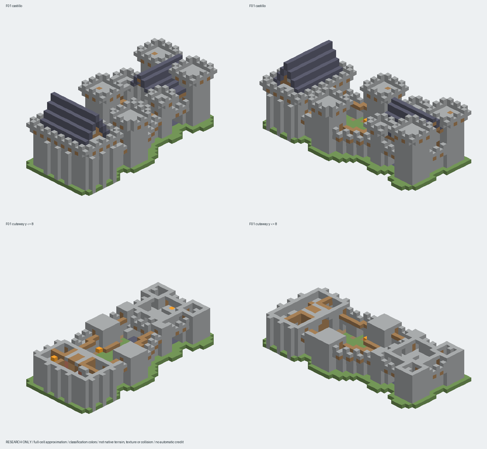
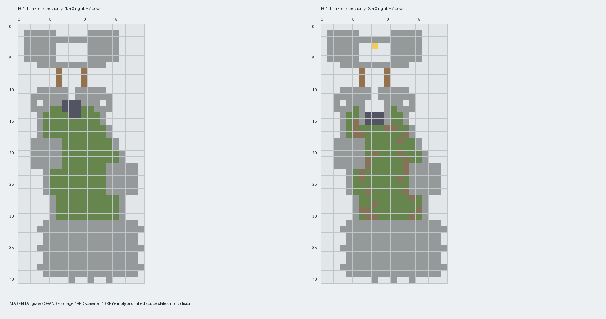
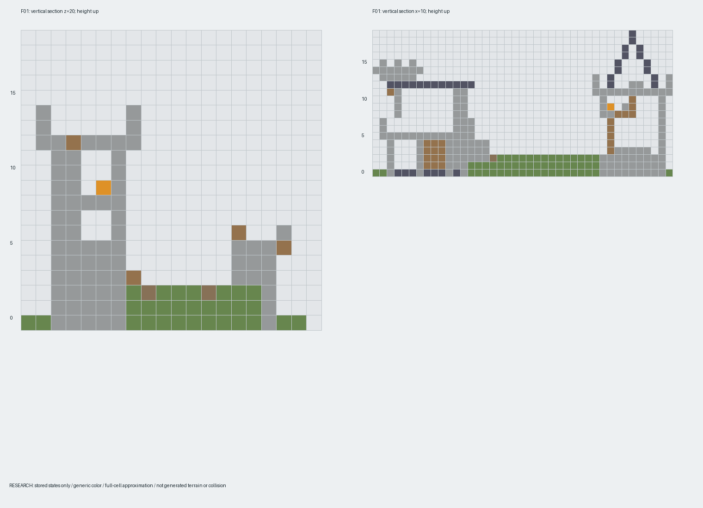
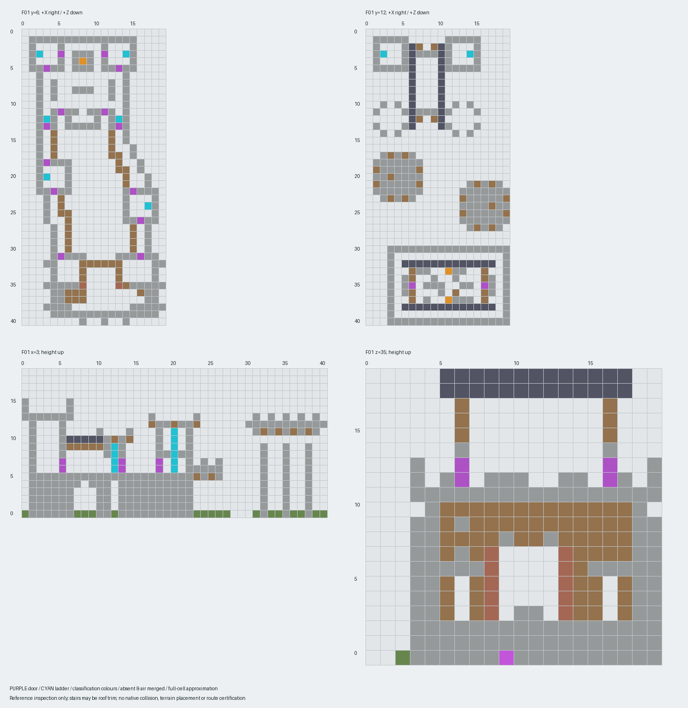

# 002-F01｜castillo.nbt

**状态：证据已整理，具体用途/规模的信用尚待协调逐例验收；未增加正式参考数。**

长院堡（20×20×41）：可借鉴狭长院落与两端厅楼、边墙短塔；不是长城、瓮城或完整古战场。

仅用于DUN03相应城防节点的空间组织学习。不是已制作资产，不是整座古战场方案；不能跨用途、跨规模自动累计。此处尺寸为保存边界，包含屋尖、台脚及空余，不等于功能净尺寸。

## 来源与完整建筑范围

- 原始归档：`/Users/a15356015027/Desktop/专业剪辑软件/虚饰作品 v1.3/overrides/mods/[冒险;ATi建筑轻量版]ATi Structures Default V1.4.2 (1.20+).jar`
- 归档SHA256：`1db9d6bbcc5032ed42e47adf42d2a719b5a768cc42af6b999ac2b1208d0730a7`
- 成员：`data/ati_structures/structures/castillo.nbt`
- NBT SHA256：`0fca7e172f35d0a4f29d396de8a18d10e5599f3df0315e81a1fcb92b89b9512f`
- [来源项目](https://www.curseforge.com/minecraft/mc-mods/ati-structures)：仅历史出处，本次未请求网络。
- 保存边界：`[20, 20, 41]`；模板外接池：`['ati_structures:terrain_small']`。这些接口没有待组装房间池；地形/实体接口仍非生成验收。

下图由本地原始NBT生成，是已经实际查看过的结构研究图；不是作者原始截图或游戏实景。阶梯、栅栏等采用整格近似，不能证明原生碰撞、贴图、落地地形或安全通关。

图像SHA256：`fcf4b100dfa61ca0716dc584e1028b06597e600fbf7bac6056404a56af8e9bf9`

图像SHA256：`f6fc9a42fadfc0eb732cc6978dd4a5f1acf98588414b9837b6f57babfdb865c7`

图像SHA256：`28f8801a91b25c791d5d69c27096bb10c9784ae49f048d5b7376accd40c313c7`

图像SHA256：`c3a3dc0e72367291b6c734f9f0c6ce785212bdc2f547913117bba8b2d3321af9`

## 七方面语义观察

- **布局**：两端厅楼与两条长边城墙围成长院；边墙有短塔，整个连院城堡为一个设计，不拆成端楼与六塔多份参考。
- **比例**：保存边界20×20×41，长宽约2.05；中院长度大于端楼深度，低长墙和两端高屋面形成长向秩序。
- **立面**：灰石塔身以短窗、垛口和木圈梁分层，端楼坡顶藏在方角塔之间；立面节奏来自房间和塔位而非贴满装饰。
- **屋顶**：两端是深色长坡屋面，边塔是露天垛口平顶；y12剖面仍有端楼上室，不能将全部塔顶当成屋脊。
- **材质**：cobblestone、stone、stone_bricks配grass_block，含dead_bubble_coral_block；分类灰色不意味着全为同一种石砖。
- **动线**：底门y1及南端双门y3对应不同底层；y6边廊连接多座短塔，x3纵剖见z12梯井y6..9及z20梯井y6..11。y12端楼双门仍可辨；未把每个门当独立副本入口。
- **地形衔接**：两个terrain_small接口为底部承托，仍属于同一城堡；草院平底不是已验证的坡地适配，未拼接接口或启动地形生成。

## 去重与验收边界

长院两端厅楼，不是旧catalonian_castle的偏侧厚主堡加短前院。

去重核对了101个历史本地归档/成员组合，含组件、待核资料，不等于有效建筑参考数。原文、旋转归一角色几何和纯占用几何均未发现完全匹配；相似度仅作辅助，不证明设计独立。
角色几何SHA256：`11b66a544e6c33742370180e816ce3709699e85bca75123162e599f4466ad61b`；纯占用几何SHA256：`1b622b99abd3845ef76bb3af0a03cf4483f4d828e5256cdb3c5291cfa58b715d`。

[完整去重证据](../research-20261101-dungeons-002/dedup-evidence.json) · [原逐例研究](../research-20261101-dungeons-002/manual-review.json)

来源、四张既有图与七方面记录已核验；完整建筑范围按整栋或整个院堡限定，塔、屋顶、楼层不能拆计。协调仍需按待制具体建筑的用途、规模审核相关性，决定是否纳入对应范围。未到该范围1000不开始制作，不因本记录删除主清单。
