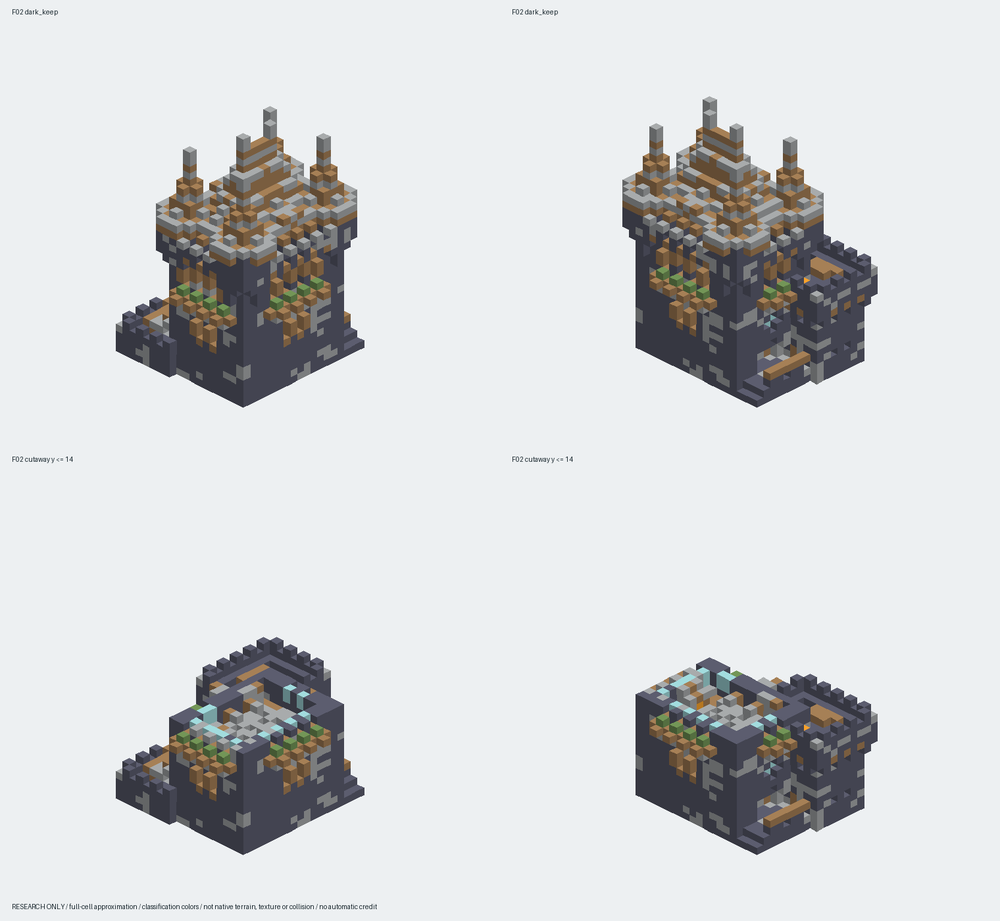
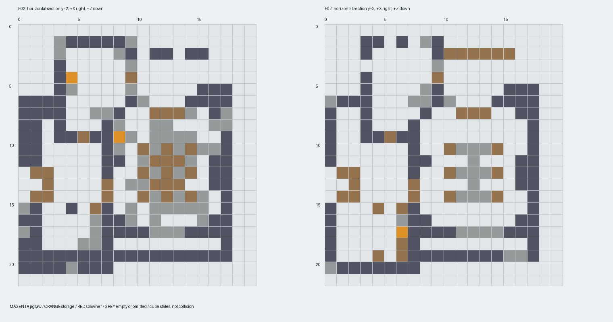
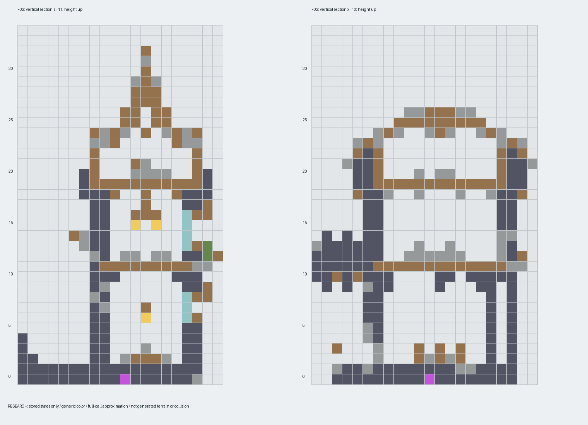
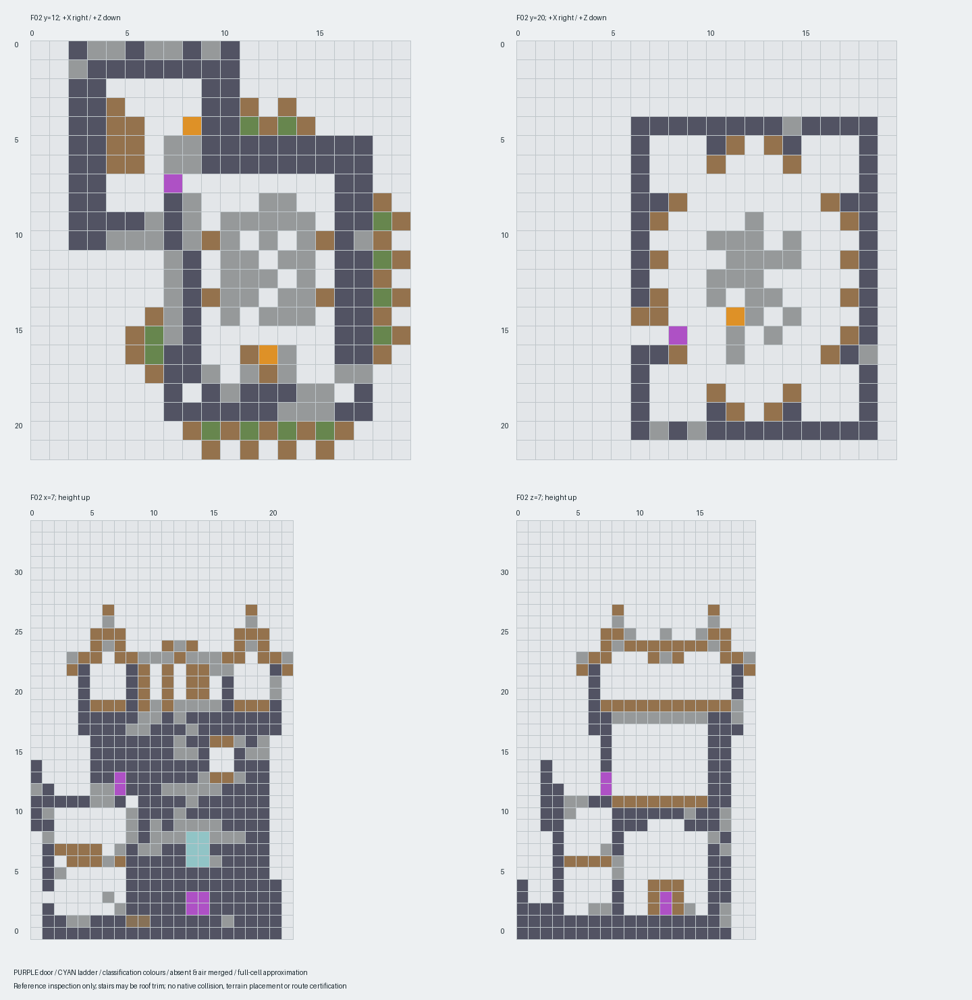

# 002-F02｜dark_keep.nbt

**状态：证据已整理，具体用途/规模的信用尚待协调逐例验收；未增加正式参考数。**

紧凑高主堡（20×35×22）：可借鉴入口附院到高主堡的层次；不覆盖低矮城墙或大规模城池。

仅用于DUN03相应城防节点的空间组织学习。不是已制作资产，不是整座古战场方案；不能跨用途、跨规模自动累计。此处尺寸为保存边界，包含屋尖、台脚及空余，不等于功能净尺寸。

## 来源与完整建筑范围

- 原始归档：`/Users/a15356015027/Desktop/专业剪辑软件/虚饰作品 v1.3/overrides/mods/[冒险;ATi建筑轻量版]ATi Structures Default V1.4.2 (1.20+).jar`
- 归档SHA256：`1db9d6bbcc5032ed42e47adf42d2a719b5a768cc42af6b999ac2b1208d0730a7`
- 成员：`data/ati_structures/structures/dark_keep.nbt`
- NBT SHA256：`db131f58a4e94c2858f5cc5ffb6d25d8e5e30bbee46245fec27f15273a2b2189`
- [来源项目](https://www.curseforge.com/minecraft/mc-mods/ati-structures)：仅历史出处，本次未请求网络。
- 保存边界：`[20, 35, 22]`；模板外接池：`['ati_structures:terrain_small']`。这些接口没有待组装房间池；地形/实体接口仍非生成验收。

下图由本地原始NBT生成，是已经实际查看过的结构研究图；不是作者原始截图或游戏实景。阶梯、栅栏等采用整格近似，不能证明原生碰撞、贴图、落地地形或安全通关。

图像SHA256：`2e6e62307b9fda6fa878e7bf93f13d0ea7e918e8dfb468beef1d324b26884c22`

图像SHA256：`291619f3cd9d9a27f4e262c1bdb0c37dda52de2a5f72ab539f0de7bef1279cf4`

图像SHA256：`ab70eebbf77888ff9b4d1e5603aaf19bacc74aefd67354377f8edee0dbc7f434`

图像SHA256：`e15738e35be897fb4fafa3f231a2bbd6e8928ea3f8cb225184921757d431c884`

## 七方面语义观察

- **布局**：高矩形主堡旁接低围合入口附院；y12为主室及外挑通廊，y20收成单个上层主室，非单一空心塔壳。
- **比例**：20×35×22，高度显著大于平面宽；底部附院压低入口，主堡屋盖形成一个集中重心。
- **立面**：深石角柱、窄窗与木挑台形成竖横两种尺度；同层外廊并不等于另一个房屋设计。
- **屋顶**：主堡尖坡顶及角部短尖饰围合一顶，上层x7/z7截面显示屋架与独立楼板；屋尖不能计作新楼层。
- **材质**：cobbled_deepslate、deepslate_bricks、deepslate、smooth_basalt、deepslate_tiles构成深石壳，木层与玻璃窗为另一材料组。
- **动线**：六个底门位于y2，另有y12与y20门；剖面见y11、19木楼板，水平图的阶梯簇位于主室内。无梯子不等于没有楼梯；尚未作真实台阶碰撞或逐层通关验证。
- **地形衔接**：一个terrain_small接口，没有外接房间池；低院与高堡在模板内完成，基座对山坡仍未验证。

## 去重与验收边界

矩形高堡加低附院；旧dark_tower为近圆鼓形平顶，F06为窄高塔接矮厅，都非同壳换材。

去重核对了101个历史本地归档/成员组合，含组件、待核资料，不等于有效建筑参考数。原文、旋转归一角色几何和纯占用几何均未发现完全匹配；相似度仅作辅助，不证明设计独立。
角色几何SHA256：`3a0ba18478c8f39a01ba15f477083fff50a35b875dbf6e48519f8ce117a58429`；纯占用几何SHA256：`23d474501a611124af9454d944d3444e756f6c7364739587047ed0b39b650910`。

[完整去重证据](../research-20261101-dungeons-002/dedup-evidence.json) · [原逐例研究](../research-20261101-dungeons-002/manual-review.json)

来源、四张既有图与七方面记录已核验；完整建筑范围按整栋或整个院堡限定，塔、屋顶、楼层不能拆计。协调仍需按待制具体建筑的用途、规模审核相关性，决定是否纳入对应范围。未到该范围1000不开始制作，不因本记录删除主清单。
