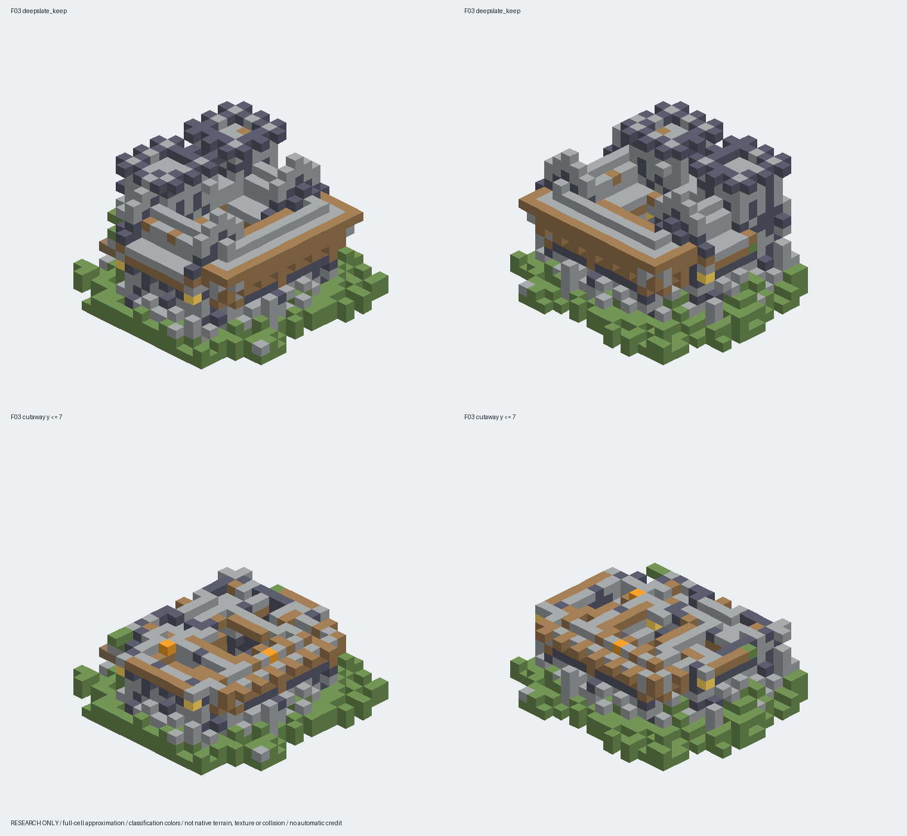
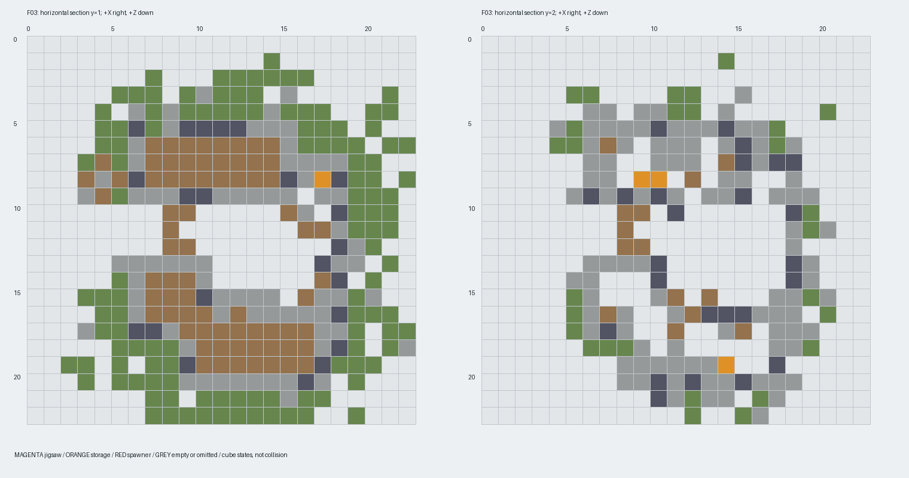
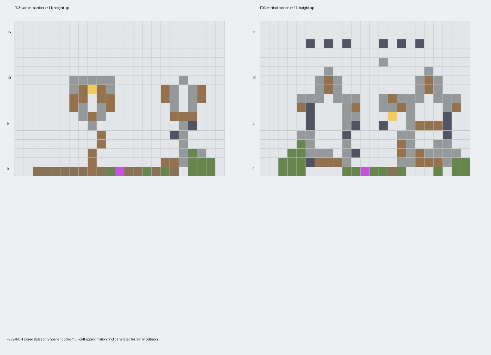
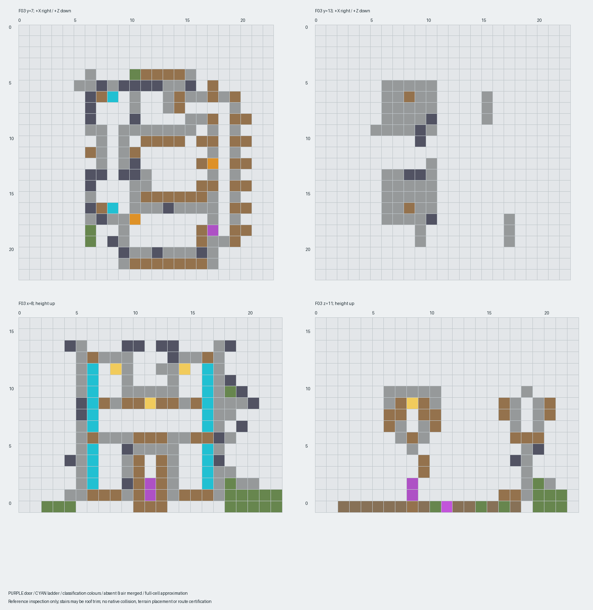

# 002-F03｜deepslate_keep.nbt

**状态：证据已整理，具体用途/规模的信用尚待协调逐例验收；未增加正式参考数。**

低双塔堡（23×17×23）：可借鉴短塔与低主屋、双梯井分工；不覆盖高塔群或大院堡。

仅用于DUN03相应城防节点的空间组织学习。不是已制作资产，不是整座古战场方案；不能跨用途、跨规模自动累计。此处尺寸为保存边界，包含屋尖、台脚及空余，不等于功能净尺寸。

## 来源与完整建筑范围

- 原始归档：`/Users/a15356015027/Desktop/专业剪辑软件/虚饰作品 v1.3/overrides/mods/[冒险;ATi建筑轻量版]ATi Structures Default V1.4.2 (1.20+).jar`
- 归档SHA256：`1db9d6bbcc5032ed42e47adf42d2a719b5a768cc42af6b999ac2b1208d0730a7`
- 成员：`data/ati_structures/structures/deepslate_keep.nbt`
- NBT SHA256：`79d76f42695d624d2f9f411edf84a8283acc259e72f2e507083010c45baa23fb`
- [来源项目](https://www.curseforge.com/minecraft/mc-mods/ati-structures)：仅历史出处，本次未请求网络。
- 保存边界：`[23, 17, 23]`；模板外接池：`['ati_structures:terrain_small']`。这些接口没有待组装房间池；地形/实体接口仍非生成验收。

下图由本地原始NBT生成，是已经实际查看过的结构研究图；不是作者原始截图或游戏实景。阶梯、栅栏等采用整格近似，不能证明原生碰撞、贴图、落地地形或安全通关。

图像SHA256：`8110c91003fb5f07508fb366c8cbcc59821e3a061a68ba29028cf33693e6976f`

图像SHA256：`35ae528486a8e0be77d586f919eaa39c567b3563b5a9cde3f20bf798c3fe3ba0`

图像SHA256：`ed118bdb111f125ce31695ab94baaa2c4815ecffbc73e1fbaa995aa78e1511a8`

图像SHA256：`90563463e6e5044e864dc6b71f9b5122e12e68de77d4481c81e046401304f2de`

## 七方面语义观察

- **布局**：低矮主屋连两座短方塔，双梯井嵌在同一侧；y7房间和木构条带保持分区，形体不是另一高堡的缩放换色。
- **比例**：23×17×23，宽高比约1.35，重心低；双塔高于主屋，但没有占满整个屋面。
- **立面**：深浅石壳与木横带围小窗，塔口短垛与主屋木边分开；不能把树叶或泥裙当承重外墙。
- **屋顶**：塔部短平顶垛口配主屋较低折坡顶；y13仅两塔及少量突件仍在，不是全平面三层大堡。
- **材质**：smooth_basalt、mud、moss_block、cobbled_deepslate及大量spruce_trapdoor；苔泥层和主石壳材料不同。
- **动线**：x8纵剖确有z6、z16两条y2..12梯井，穿过约y6、9楼板；底门在y1/2，上门y7。梯井支持上下联系意图，梯口落脚净空未以游戏验证。
- **地形衔接**：泥苔不规则底裙加terrain_small承托；边界内没有可证明的悬崖或天然洞口连接。

## 去重与验收边界

双短塔加低厅及双长梯；已重看rotting_temple，其多级方台中心高台与此双塔围房不同。

去重核对了101个历史本地归档/成员组合，含组件、待核资料，不等于有效建筑参考数。原文、旋转归一角色几何和纯占用几何均未发现完全匹配；相似度仅作辅助，不证明设计独立。
角色几何SHA256：`0fa8c3d3043c0a9a951f094eb2b4fac7c4864f95a9886aeed7ae33bf49643b50`；纯占用几何SHA256：`54c462a7a9eed23d96741ef0c992e74a02041f90e4b2c7854e0de091d13c95b3`。

[完整去重证据](../research-20261101-dungeons-002/dedup-evidence.json) · [原逐例研究](../research-20261101-dungeons-002/manual-review.json)

来源、四张既有图与七方面记录已核验；完整建筑范围按整栋或整个院堡限定，塔、屋顶、楼层不能拆计。协调仍需按待制具体建筑的用途、规模审核相关性，决定是否纳入对应范围。未到该范围1000不开始制作，不因本记录删除主清单。
