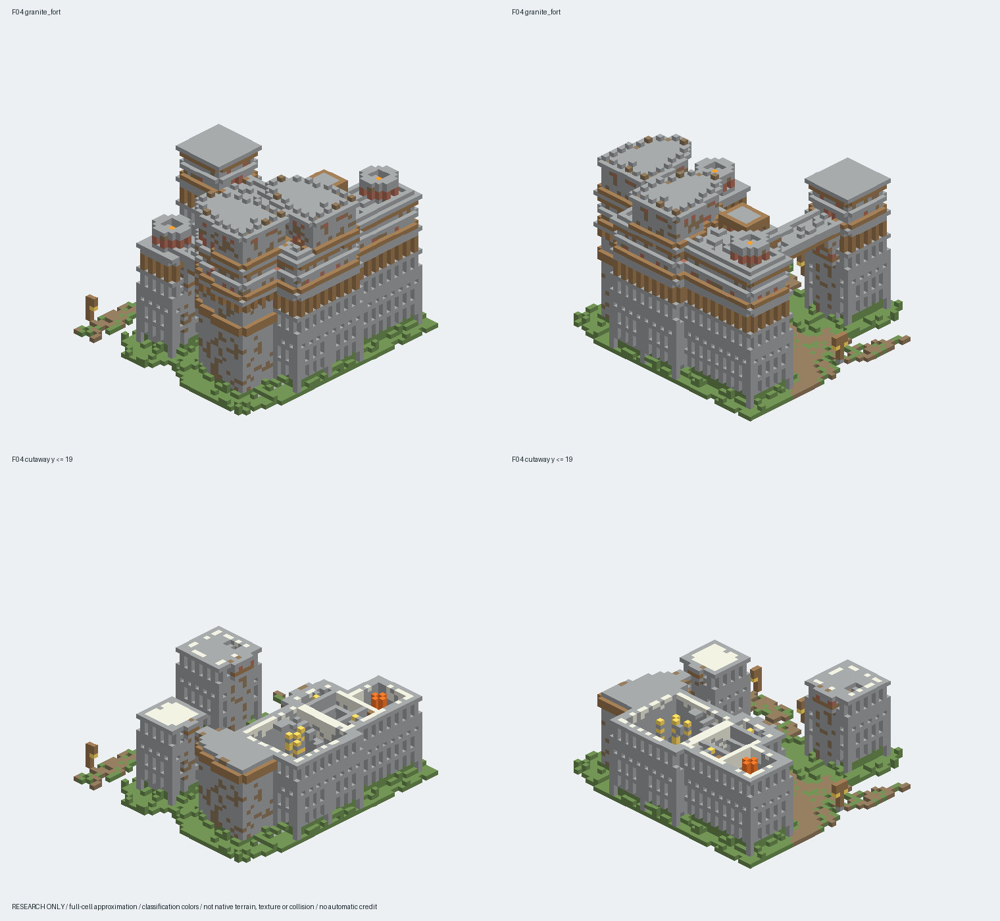
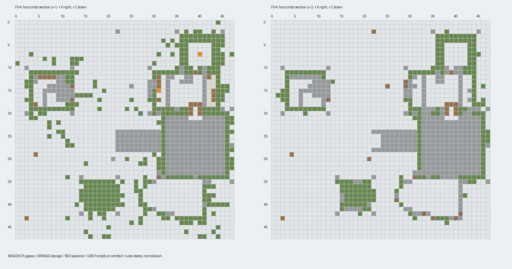
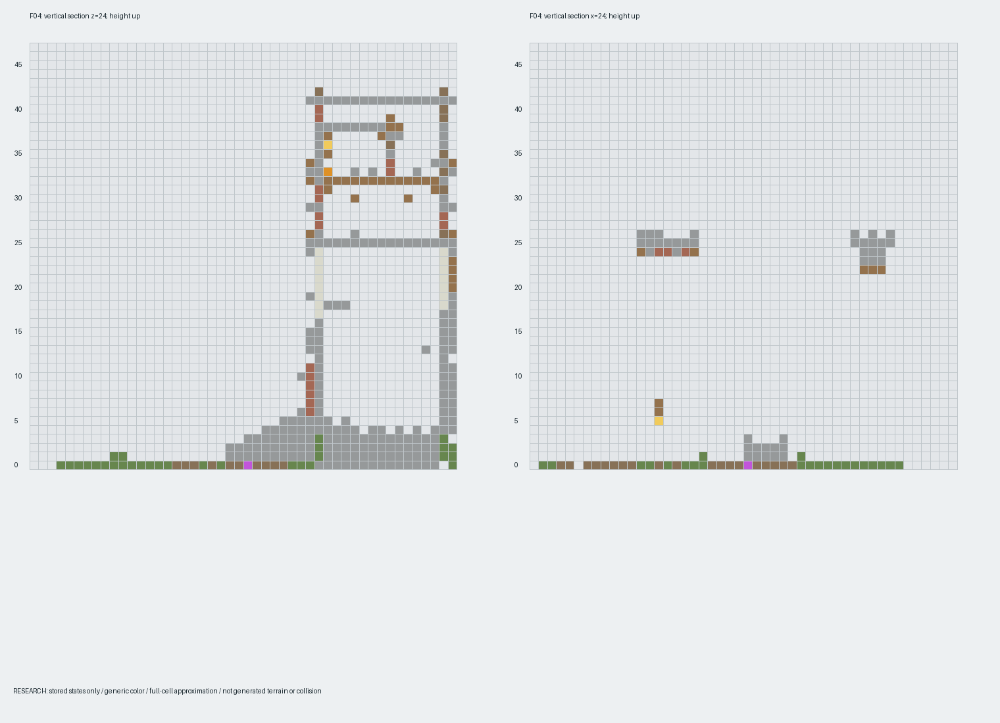
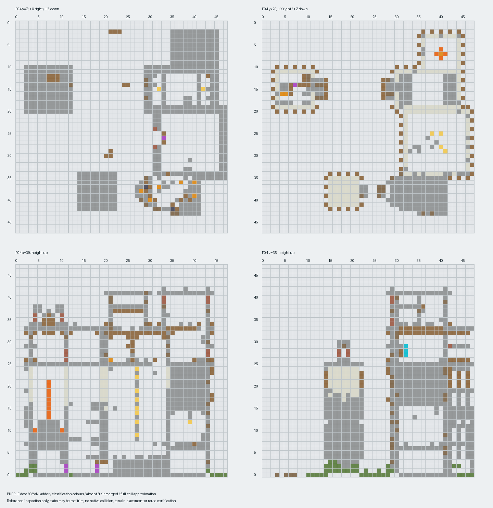

# 002-F04｜granite_fort.nbt

**状态：证据已整理，具体用途/规模的信用尚待协调逐例验收；未增加正式参考数。**

大型偏置院堡（48³保存边界）：可借鉴主堡、独立门塔与开院的主次；不能直接代表中式瓮城结构。

仅用于DUN03相应城防节点的空间组织学习。不是已制作资产，不是整座古战场方案；不能跨用途、跨规模自动累计。此处尺寸为保存边界，包含屋尖、台脚及空余，不等于功能净尺寸。

## 来源与完整建筑范围

- 原始归档：`/Users/a15356015027/Desktop/专业剪辑软件/虚饰作品 v1.3/overrides/mods/[冒险;ATi建筑轻量版]ATi Structures Default V1.4.2 (1.20+).jar`
- 归档SHA256：`1db9d6bbcc5032ed42e47adf42d2a719b5a768cc42af6b999ac2b1208d0730a7`
- 成员：`data/ati_structures/structures/granite_fort.nbt`
- NBT SHA256：`5d6658634f5f712edd9cf5e831101e0144bad2c74d1b7a2af717980534e0c9b0`
- [来源项目](https://www.curseforge.com/minecraft/mc-mods/ati-structures)：仅历史出处，本次未请求网络。
- 保存边界：`[48, 48, 48]`；模板外接池：`['ati_structures:terrain_large']`。这些接口没有待组装房间池；地形/实体接口仍非生成验收。

下图由本地原始NBT生成，是已经实际查看过的结构研究图；不是作者原始截图或游戏实景。阶梯、栅栏等采用整格近似，不能证明原生碰撞、贴图、落地地形或安全通关。

图像SHA256：`efe92f01055d1fed5340a6c9e3cf15227f493bc0f21bd4242c2d9421e127bac3`

图像SHA256：`7e7f80325369f759bf5b1f8b8dce5803a16b19f4b359c9d76acc00aae9243916`

图像SHA256：`f0cb5f7c759b739dbc0010b3deb7db48ec9a09e4c6bae6a645636a9fd3a88dde`

图像SHA256：`3cd52efb9e2df78d70f2ab32a4590d17fe0b11400456a91cad63b4c9605e4c09`

## 七方面语义观察

- **布局**：主体偏东的高层主堡与西侧独立门塔、南侧小塔围合大院；中央剖面切中空院曾漏掉主室，x39与z35补剖才显示实际楼层。
- **比例**：48×48×48是保存上限，主要高堡到约y42，宽院与偏侧高体形成非对称重心；不能将空院误作缺失建筑。
- **立面**：方塔层层木石腰带、开窗和立柱分节，高主堡立面有多级外挑；门塔与主堡共享构造语言但占地和用途不同。
- **屋顶**：主屋平顶、垛口及小塔帽组合，上部另有小室；高低屋顶关系清楚，不是三个同高方块叠加。
- **材质**：smooth_stone_slab、smooth_stone、dripstone_block、rooted_dirt和light_gray_concrete_powder等混合；原始状态有77格lava，不能把橙色竖列都当箱子。
- **动线**：东主堡底门(39,1,11)/(39,1,18)，院侧门(33,6,26)，西门塔门y8/20；补剖有多层地板及x32,z35的y27..29梯段。楼梯广布y1..34，屋顶装饰阶梯不可自动算路线。
- **地形衔接**：terrain_large底接口未展开；院内高差、门塔台脚和主堡承台属于模板内，不等于已连上自然山崖。

## 去重与验收边界

偏侧高方堡、独立门塔与宽院；旧ancient_temple为中央台塔加对称整方多层，非同设计。

去重核对了101个历史本地归档/成员组合，含组件、待核资料，不等于有效建筑参考数。原文、旋转归一角色几何和纯占用几何均未发现完全匹配；相似度仅作辅助，不证明设计独立。
角色几何SHA256：`14d73f96f4c0b2763ec1e6c643c59b18231aaa9fa215a37571d496d3316dd30e`；纯占用几何SHA256：`7751710c37d60893f431eb47d84a4fab5b8b32a539dff54cf2377a1db455b7fa`。

[完整去重证据](../research-20261101-dungeons-002/dedup-evidence.json) · [原逐例研究](../research-20261101-dungeons-002/manual-review.json)

来源、四张既有图与七方面记录已核验；完整建筑范围按整栋或整个院堡限定，塔、屋顶、楼层不能拆计。协调仍需按待制具体建筑的用途、规模审核相关性，决定是否纳入对应范围。未到该范围1000不开始制作，不因本记录删除主清单。
