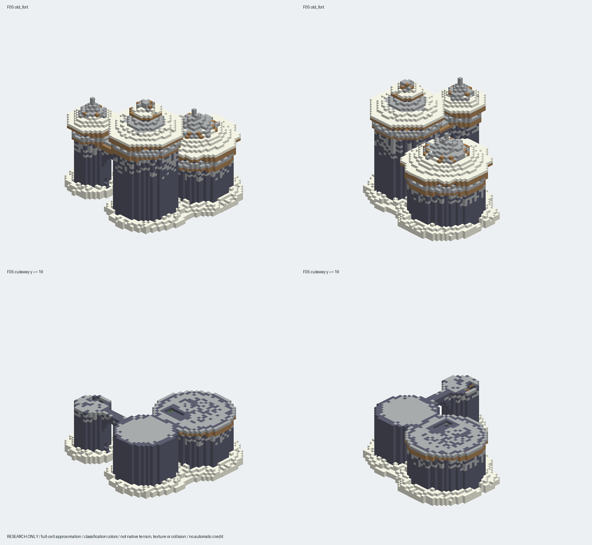
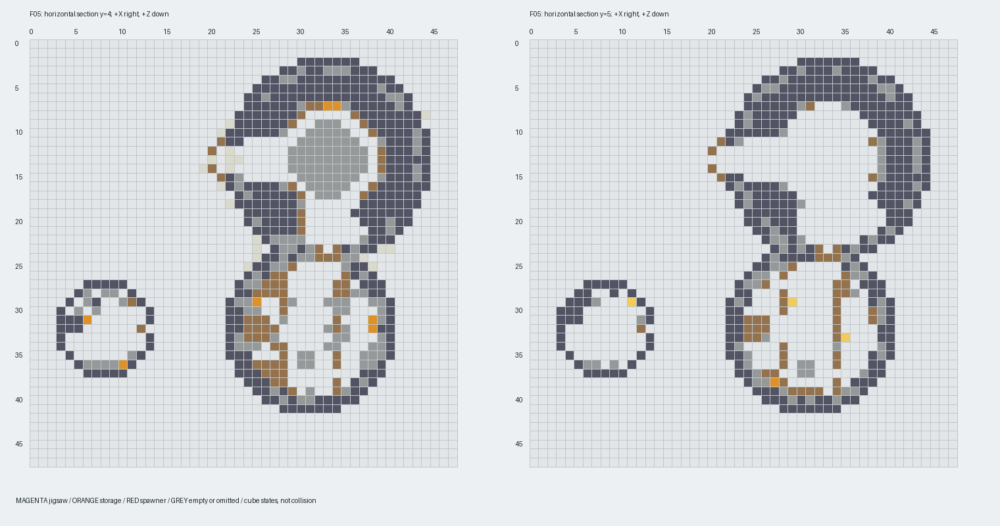
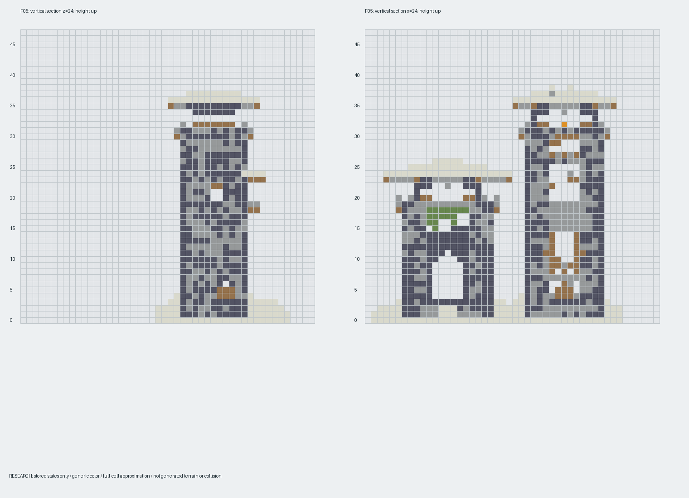
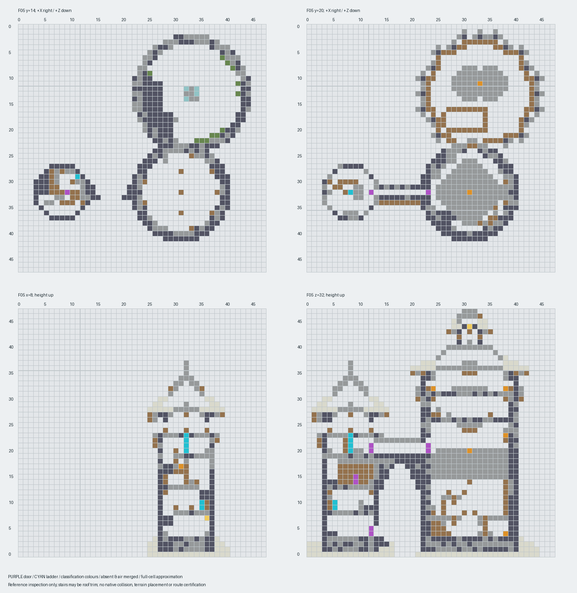

# 002-F05｜old_fort.nbt

**状态：证据已整理，具体用途/规模的信用尚待协调逐例验收；未增加正式参考数。**

三圆塔桥堡（48³保存边界）：可借鉴高位桥连接不同塔室；不是三栋独立参考，也不覆盖城墙围院。

仅用于DUN03相应城防节点的空间组织学习。不是已制作资产，不是整座古战场方案；不能跨用途、跨规模自动累计。此处尺寸为保存边界，包含屋尖、台脚及空余，不等于功能净尺寸。

## 来源与完整建筑范围

- 原始归档：`/Users/a15356015027/Desktop/专业剪辑软件/虚饰作品 v1.3/overrides/mods/[冒险;ATi建筑轻量版]ATi Structures Default V1.4.2 (1.20+).jar`
- 归档SHA256：`1db9d6bbcc5032ed42e47adf42d2a719b5a768cc42af6b999ac2b1208d0730a7`
- 成员：`data/ati_structures/structures/old_fort.nbt`
- NBT SHA256：`cf8e6a70ee8370543e6c6cae643b26dadfdca191324d1169d1ab29bc188a0d31`
- [来源项目](https://www.curseforge.com/minecraft/mc-mods/ati-structures)：仅历史出处，本次未请求网络。
- 保存边界：`[48, 48, 48]`；模板外接池：`['ati_structures:terrain_large']`。这些接口没有待组装房间池；地形/实体接口仍非生成验收。

下图由本地原始NBT生成，是已经实际查看过的结构研究图；不是作者原始截图或游戏实景。阶梯、栅栏等采用整格近似，不能证明原生碰撞、贴图、落地地形或安全通关。

图像SHA256：`1ad7f42883e53de89bc1dbcc9921e4f732b53443416cc6dd66e7045df4cfcb38`

图像SHA256：`d39a58ffbd64249413dcd3caa151edfa8b704cc4bd6652c3c7370a3a004b728a`

图像SHA256：`4ee108d103d6c9b624f9d26280b9e89cc980bcfcc08cb5c852b06cefec7d71be`

图像SHA256：`55dd5267abb4e1e98d17b090ffd2c662c166da9606d87a2e16645530c8c94eec`

## 七方面语义观察

- **布局**：三座不同直径圆塔通过高位桥相连；小侧塔先有独立底部，y20桥连向大圆塔，是完整塔堡组合而非三种圆塔组件。
- **比例**：48³保存边界，圆塔大小和高度不一，桥宽明显小于塔径；塔间留空使组合有主次，不能按三次重复计数。
- **立面**：圆壳用分层黑石、木圈梁与雪沿形成横带，弧面边界随高度收分，不是方墙简单涂白。
- **屋顶**：三塔阶梯尖帽和雪覆宽檐；侧塔剖面出现木层和上方坡顶，雪沿不代表可用室内。
- **材质**：smooth_basalt、deepslate_bricks、snow_block、snow及polished_blackstone_bricks为主，白色确有雪状态。
- **动线**：底铁门(12,4,32)进入小塔；小塔高门(12,20,32)与大塔门(23,20,32)位于同一桥轴，z32剖面可见桥和两端门。x8,z32梯井y20..23上行；完整防御布局已见，未声称所有桥的游戏碰撞已验。
- **地形衔接**：雪裙与圆台在模板内，terrain_large为承托；未获得雪地实际生成或悬空桥端着地证据。

## 去重与验收边界

三个异径雪覆圆塔和高桥；旧ruined_castle为密集方塔残墙和单外桥，非同壳破损版。

去重核对了101个历史本地归档/成员组合，含组件、待核资料，不等于有效建筑参考数。原文、旋转归一角色几何和纯占用几何均未发现完全匹配；相似度仅作辅助，不证明设计独立。
角色几何SHA256：`17185f0115a3c71173af18d379e62949d8b983631f8c67b03a689c266a21cde8`；纯占用几何SHA256：`32ad816b29d58d13cb682bf689d39c22eade114e51c91968f51b5804fcba686a`。

[完整去重证据](../research-20261101-dungeons-002/dedup-evidence.json) · [原逐例研究](../research-20261101-dungeons-002/manual-review.json)

来源、四张既有图与七方面记录已核验；完整建筑范围按整栋或整个院堡限定，塔、屋顶、楼层不能拆计。协调仍需按待制具体建筑的用途、规模审核相关性，决定是否纳入对应范围。未到该范围1000不开始制作，不因本记录删除主清单。
