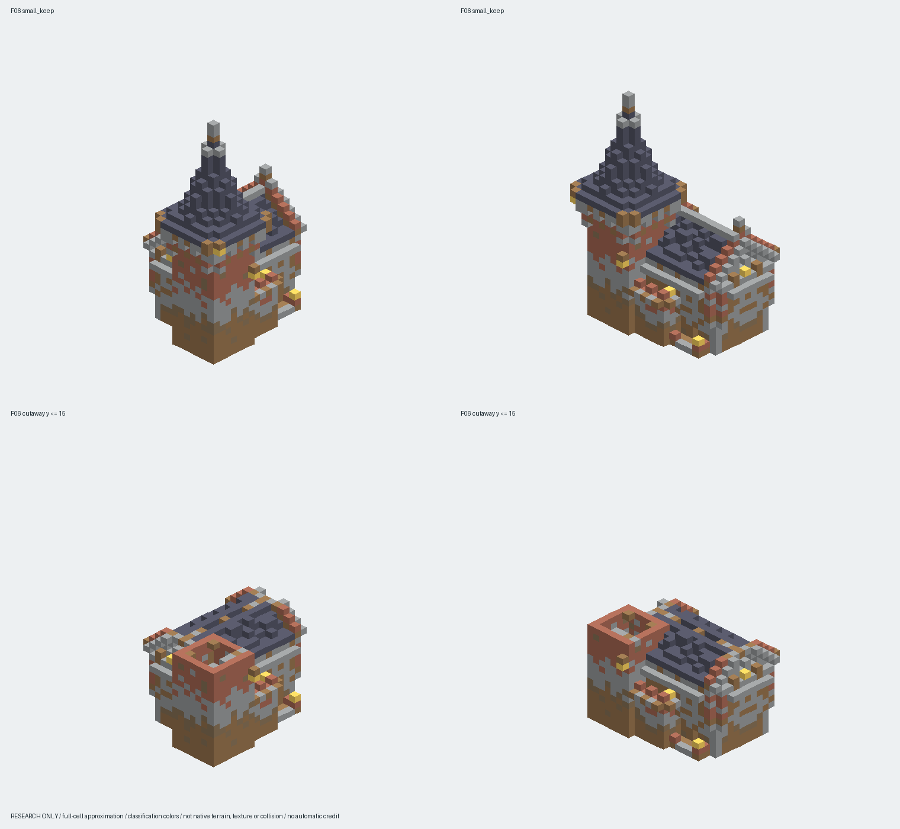
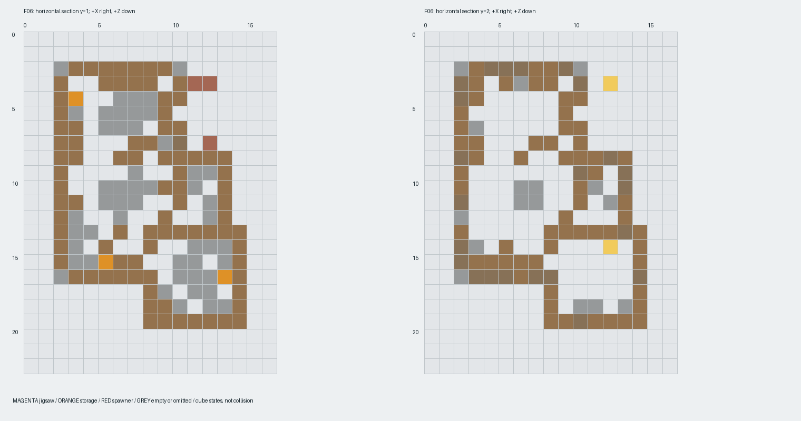
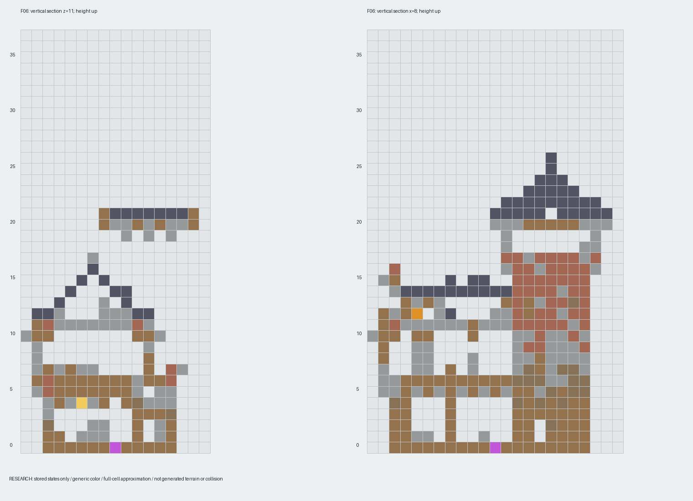
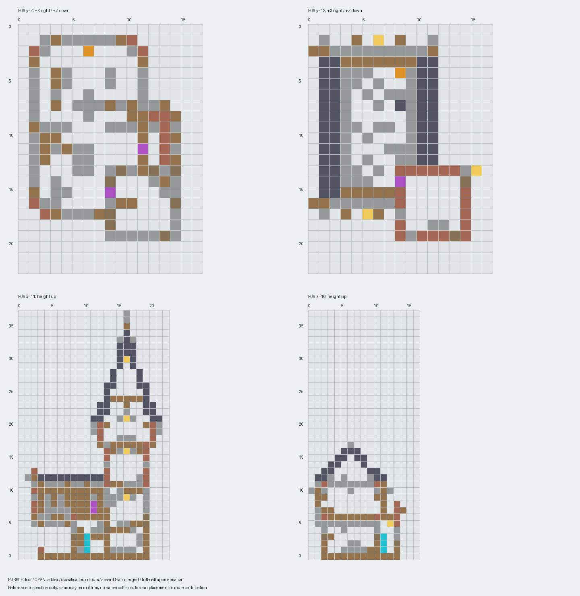

# 002-F06｜small_keep.nbt

**状态：证据已整理，具体用途/规模的信用尚待协调逐例验收；未增加正式参考数。**

紧凑尖塔连低厅（17×38×23）：可借鉴单高塔与低厅体量；不覆盖大型多角塔城。

仅用于DUN03相应城防节点的空间组织学习。不是已制作资产，不是整座古战场方案；不能跨用途、跨规模自动累计。此处尺寸为保存边界，包含屋尖、台脚及空余，不等于功能净尺寸。

## 来源与完整建筑范围

- 原始归档：`/Users/a15356015027/Desktop/专业剪辑软件/虚饰作品 v1.3/overrides/mods/[冒险;ATi建筑轻量版]ATi Structures Default V1.4.2 (1.20+).jar`
- 归档SHA256：`1db9d6bbcc5032ed42e47adf42d2a719b5a768cc42af6b999ac2b1208d0730a7`
- 成员：`data/ati_structures/structures/small_keep.nbt`
- NBT SHA256：`acb045b43cbacc02703e467485551a5e209a36e5c6f50a9847d6e3956d05b9a8`
- [来源项目](https://www.curseforge.com/minecraft/mc-mods/ati-structures)：仅历史出处，本次未请求网络。
- 保存边界：`[17, 38, 23]`；模板外接池：`['ati_structures:terrain_small']`。这些接口没有待组装房间池；地形/实体接口仍非生成验收。

下图由本地原始NBT生成，是已经实际查看过的结构研究图；不是作者原始截图或游戏实景。阶梯、栅栏等采用整格近似，不能证明原生碰撞、贴图、落地地形或安全通关。

图像SHA256：`2f25e52cb45338c174f2fa1df9d8e8f00800e57ac6011011604ef109609fdc74`

图像SHA256：`1829777beebe775419d795be9b049d561aebeea8165e209934a9e720f057c341`

图像SHA256：`bc4c7d2961ef55efd9959bea95f9c4c47132ac4686dbfcb97ea02c6df7e38226`

图像SHA256：`f9f40f647b8e55a036ee5044be2f6d676c731a7d6df050fc836f5e9dc9cccb6b`

## 七方面语义观察

- **布局**：一座高窄塔与两块低厅相接，底层房间紧密组合；高塔与矮厅通过侧门联系，非F02主堡加入口院的同平面变色。
- **比例**：17×38×23，x11补剖可见尖饰达到约y37，实际房间集中下部和塔中部；尖饰长度不能折算成人可用净高。
- **立面**：红褐砌体、木柱和横带混用，塔窗与矮厅窗口尺度不同；高塔一角突出形成方向性。
- **屋顶**：高塔深色陡尖顶配低厅缓坡屋面，顶脊有细长装饰；屋顶形式区别于森林小礼拜堂的双山墙坡顶。
- **材质**：spruce_trapdoor、mud_bricks、spruce_stairs、oak_wood和spruce_planks占主导；原图红褐不应误记成红砖。
- **动线**：底门y1，上门y7/12；x11,z10梯段仅y1..3，不能把它写为通顶长梯。补图见矮厅y7及高塔y12分室，塔内阶梯仍需与装饰台阶区分。
- **地形衔接**：terrain_small的final_state为spruce_planks；不是泥土承托的默认实例，未验证实际地形接缝。

## 去重与验收边界

窄尖塔与低厅簇；重看forest_chapel为两块相连山墙厅，平面、主塔和屋顶组织不同。

去重核对了101个历史本地归档/成员组合，含组件、待核资料，不等于有效建筑参考数。原文、旋转归一角色几何和纯占用几何均未发现完全匹配；相似度仅作辅助，不证明设计独立。
角色几何SHA256：`14e3faf1be984a576f56627606e9a76686c69cd125ec9e0fb4916819af7afff9`；纯占用几何SHA256：`519dc9a9b9662aae12178a87a4b6b1ff2c4d93bb24eecea2ffd7483bfb7790ab`。

[完整去重证据](../research-20261101-dungeons-002/dedup-evidence.json) · [原逐例研究](../research-20261101-dungeons-002/manual-review.json)

来源、四张既有图与七方面记录已核验；完整建筑范围按整栋或整个院堡限定，塔、屋顶、楼层不能拆计。协调仍需按待制具体建筑的用途、规模审核相关性，决定是否纳入对应范围。未到该范围1000不开始制作，不因本记录删除主清单。
