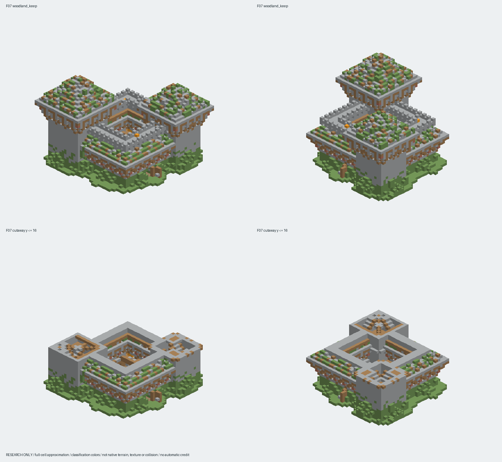
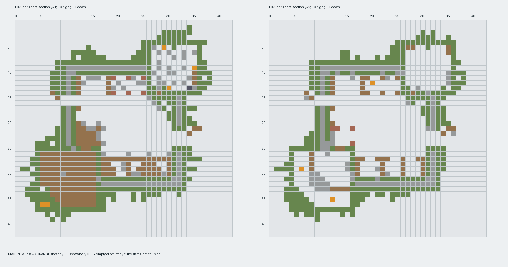
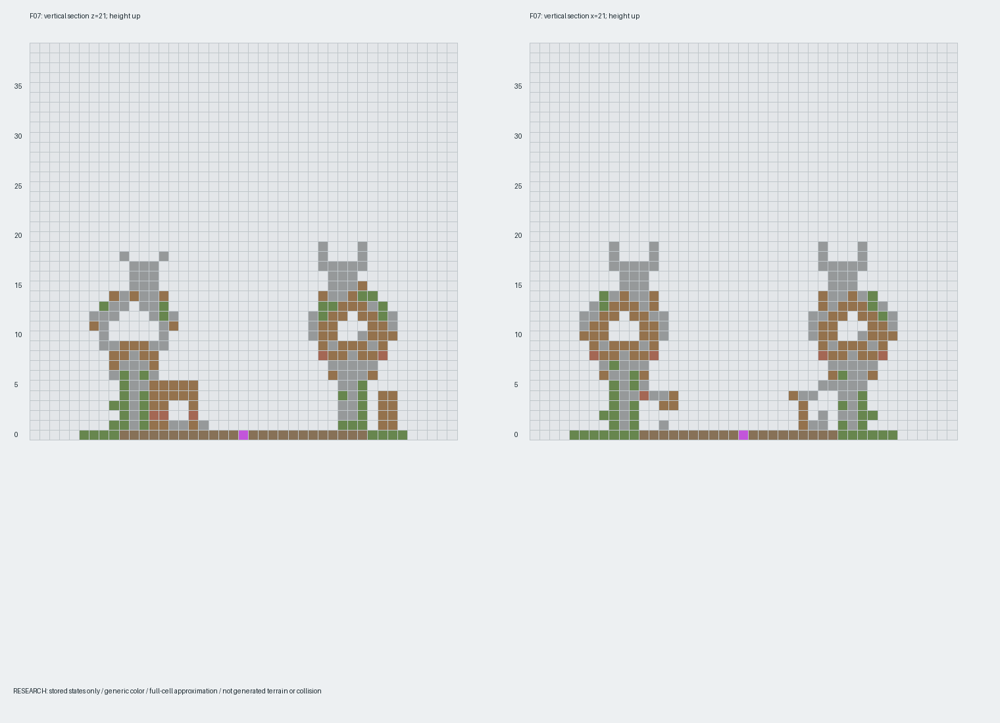
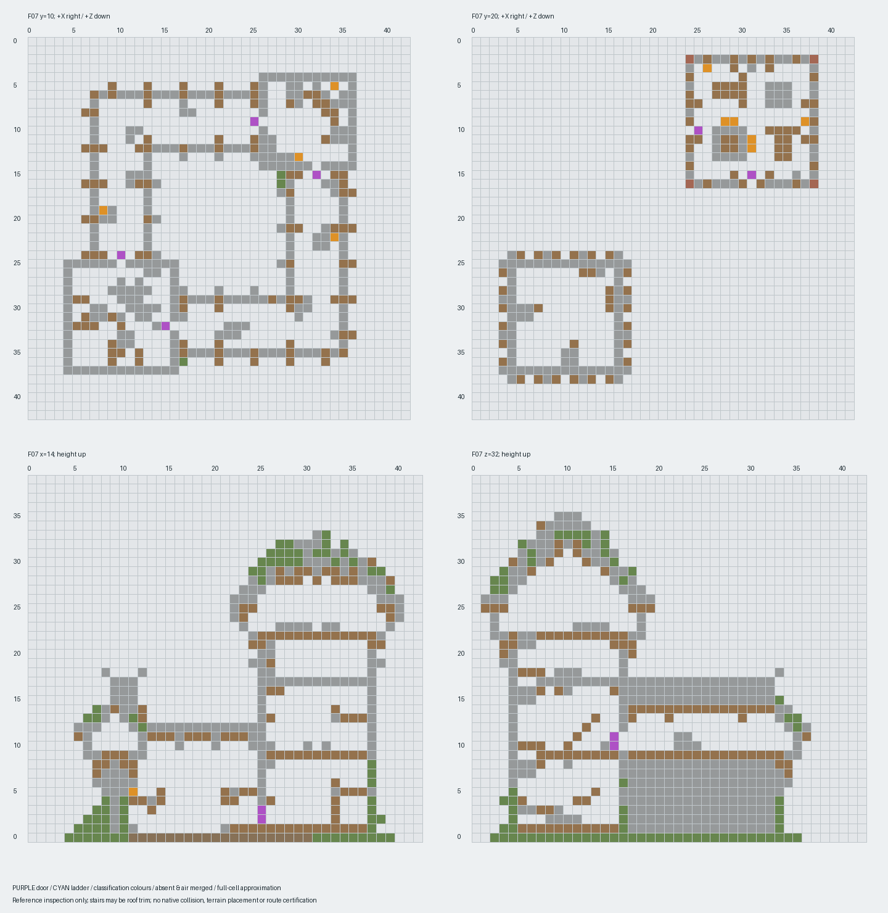

# 002-F07｜woodland_keep.nbt

**状态：证据已整理，具体用途/规模的信用尚待协调逐例验收；未增加正式参考数。**

环院双高楼堡（43×40×43）：可借鉴低围廊与对角高楼的联系；不等于中式官衙或地下城全局。

仅用于DUN03相应城防节点的空间组织学习。不是已制作资产，不是整座古战场方案；不能跨用途、跨规模自动累计。此处尺寸为保存边界，包含屋尖、台脚及空余，不等于功能净尺寸。

## 来源与完整建筑范围

- 原始归档：`/Users/a15356015027/Desktop/专业剪辑软件/虚饰作品 v1.3/overrides/mods/[冒险;ATi建筑轻量版]ATi Structures Default V1.4.2 (1.20+).jar`
- 归档SHA256：`1db9d6bbcc5032ed42e47adf42d2a719b5a768cc42af6b999ac2b1208d0730a7`
- 成员：`data/ati_structures/structures/woodland_keep.nbt`
- NBT SHA256：`5cad8bef58059106f1b6f90ac0992ced9447919f815b4bcc4baf8b68c3b3d16e`
- [来源项目](https://www.curseforge.com/minecraft/mc-mods/ati-structures)：仅历史出处，本次未请求网络。
- 保存边界：`[43, 40, 43]`；模板外接池：`['ati_structures:terrain_large']`。这些接口没有待组装房间池；地形/实体接口仍非生成验收。

下图由本地原始NBT生成，是已经实际查看过的结构研究图；不是作者原始截图或游戏实景。阶梯、栅栏等采用整格近似，不能证明原生碰撞、贴图、落地地形或安全通关。

图像SHA256：`d4ea01bc1254880df7e3f71b8d0a48792cdfc2ea96e052e9528124e266f44c90`

图像SHA256：`00f71a45137a598fdd8678a14c4c49f0caa5d1de9e4fa3eefa485a8889f9f31a`

图像SHA256：`8b9a45370000c7ca88a52a9d9c5b31b985700423947913c9fbc7e5782a864ea3`

图像SHA256：`8910d060808a9185df5a550a3f94ad7f7c05b1744b43c703db5c4a4a2be453e3`

## 七方面语义观察

- **布局**：围廊包空院，两个对角高楼与低角部体量围成一堡；y10为连续环院层，y20只保留两座分开的高楼。
- **比例**：43×40×43宽基座，中院宽、外围廊低，高楼位于对角；高低屋面有均衡而非完全等高镜像。
- **立面**：石墙木腰带、成排内院开口和角楼窗形成分层界面，苔屋面与墙边植被并非额外楼体。
- **屋顶**：角楼大坡顶覆苔与灰石边，低屋顶围院连续，高层屋面只在两角；不能将一圈檐拆作四栋建筑。
- **材质**：stone_bricks、spruce_trapdoor、moss_block、oak_planks、stone配多种叶与泥；苔绿不是现成贴图观感。
- **动线**：主双门(13/14,2,25)，上层门集中y10以及y18/20；y10平面和z32剖面确认上层围廊与侧房关系，y20两楼要经下层联系，不能在院上凭空假定一座高桥。
- **地形衔接**：宽草泥台裙和terrain_large承托；植物遮挡真实台脚，未证明适用于天然悬崖。

## 去重与验收边界

空院环廊加两座对角高楼；旧ruined_castle中心密室多塔，旧villager_castle为宽墙院加一侧高坡主厅。

去重核对了101个历史本地归档/成员组合，含组件、待核资料，不等于有效建筑参考数。原文、旋转归一角色几何和纯占用几何均未发现完全匹配；相似度仅作辅助，不证明设计独立。
角色几何SHA256：`2b76fb95ab1106d36e060567898faa1ca85f6eb3efc90f3d19c8e01ce092735d`；纯占用几何SHA256：`6510a40bc037db69858fb0b3b526aff0d737ffb6e6c3d16c5032c21faad67c47`。

[完整去重证据](../research-20261101-dungeons-002/dedup-evidence.json) · [原逐例研究](../research-20261101-dungeons-002/manual-review.json)

来源、四张既有图与七方面记录已核验；完整建筑范围按整栋或整个院堡限定，塔、屋顶、楼层不能拆计。协调仍需按待制具体建筑的用途、规模审核相关性，决定是否纳入对应范围。未到该范围1000不开始制作，不因本记录删除主清单。
