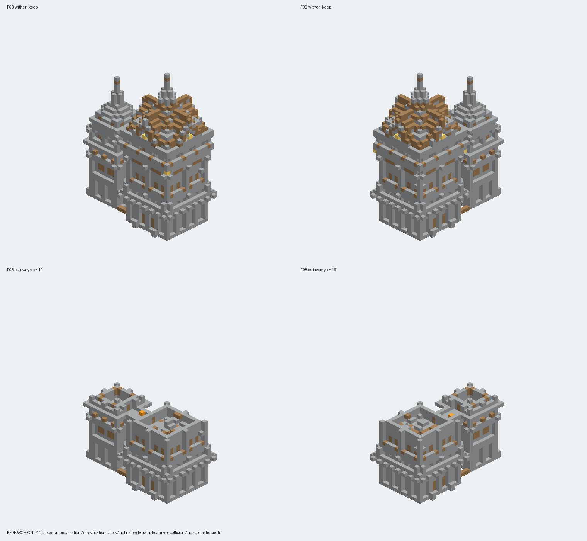
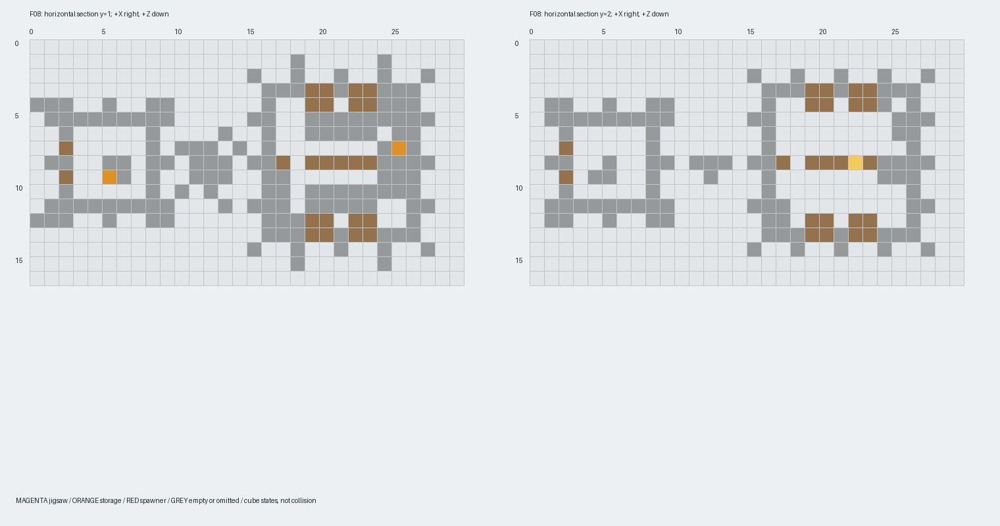
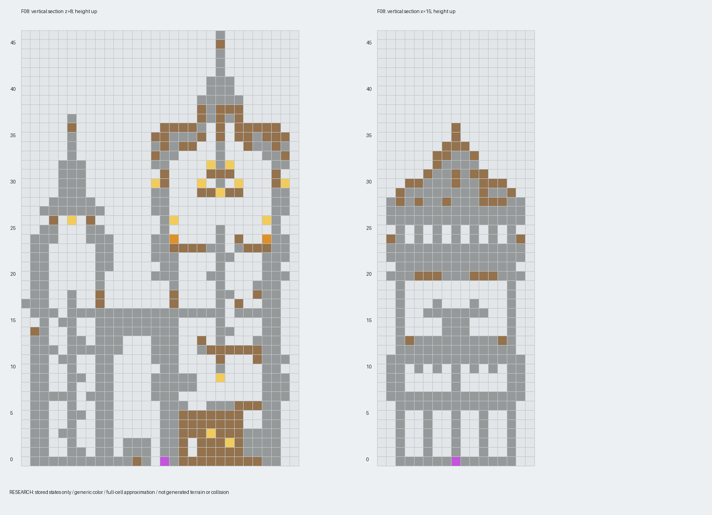
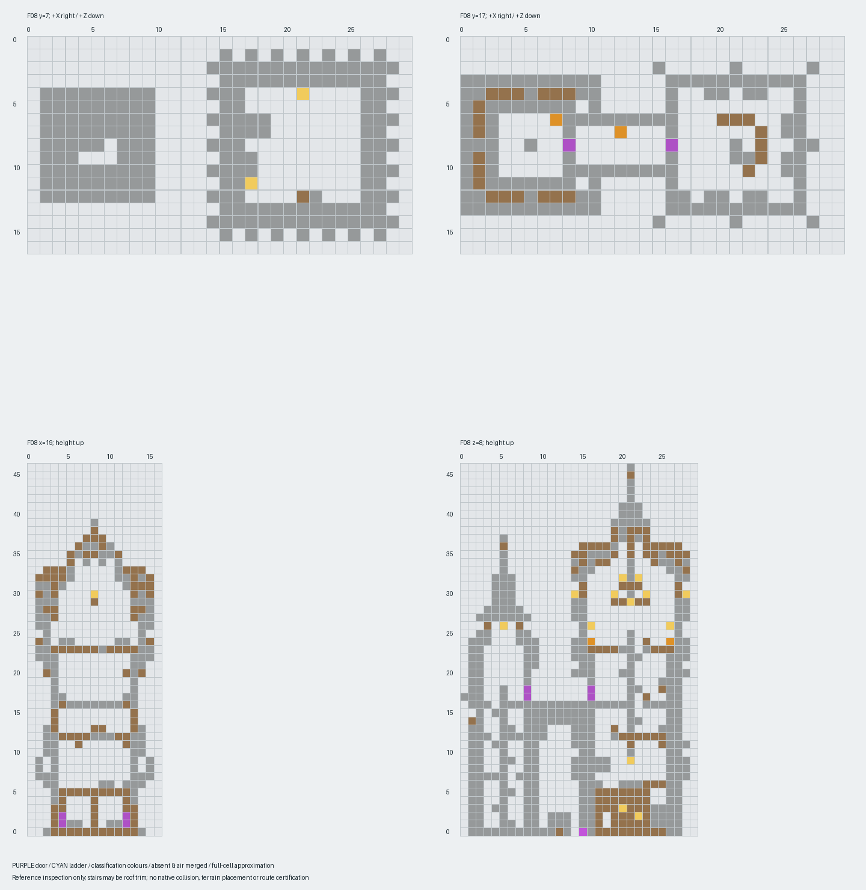

# 002-F08｜wither_keep.nbt

**状态：证据已整理，具体用途/规模的信用尚待协调逐例验收；未增加正式参考数。**

长窄并排高厅堡（30×47×17）：可借鉴双厅间中层交通；不覆盖露天战场或大院堡。

仅用于DUN03相应城防节点的空间组织学习。不是已制作资产，不是整座古战场方案；不能跨用途、跨规模自动累计。此处尺寸为保存边界，包含屋尖、台脚及空余，不等于功能净尺寸。

## 来源与完整建筑范围

- 原始归档：`/Users/a15356015027/Desktop/专业剪辑软件/虚饰作品 v1.3/overrides/mods/[冒险;ATi建筑轻量版]ATi Structures Default V1.4.2 (1.20+).jar`
- 归档SHA256：`1db9d6bbcc5032ed42e47adf42d2a719b5a768cc42af6b999ac2b1208d0730a7`
- 成员：`data/ati_structures/structures/wither_keep.nbt`
- NBT SHA256：`5d311443e76792f2b458474dc07d9ed806dd061ae86da86e0c97f7119a3aea50`
- [来源项目](https://www.curseforge.com/minecraft/mc-mods/ati-structures)：仅历史出处，本次未请求网络。
- 保存边界：`[30, 47, 17]`；模板外接池：`['ati_structures:terrain_small']`。这些接口没有待组装房间池；地形/实体接口仍非生成验收。

下图由本地原始NBT生成，是已经实际查看过的结构研究图；不是作者原始截图或游戏实景。阶梯、栅栏等采用整格近似，不能证明原生碰撞、贴图、落地地形或安全通关。

图像SHA256：`e026870970a905f0bdf89cf4f8fb7fb6f173d6490b8463d3e28b53deb232da85`

图像SHA256：`dfc5e47eba4b6891bba2d08d19a6dc8294336b9f3f37524627fc00e50b30410a`

图像SHA256：`a20b4d7c0cff5296f3da393108c1a880d1e5864590122c8ac3adfe6e61d64600`

图像SHA256：`01b6492f4d4ff48099d2050ee545856ab69139a821fee70d44a1281e946aa82b`

## 七方面语义观察

- **布局**：两座并排高厅/塔体用中段交通相接，主厅更高、更长；y17两门相对，通过同层中部地板联系。
- **比例**：30×47×17长窄占地，高主屋及极细尖饰决定高度；主副屋高差明显，不能按47格都作功能层。
- **立面**：石柱与木腰带夹高窄窗，warped门窗件形成细部差异；同一长立面先用体量分段再用材质。
- **屋顶**：主屋高坡顶与副屋较低坡顶并排，脊顶尖饰有高度差；无大庭院或多座独立神殿。
- **材质**：polished_andesite、dark_oak_planks、andesite、gravel、warped_trapdoor为主；名称wither不证明是凋灵Boss场地。
- **动线**：底层warped门多在y1，连接门在(8,17,8)/(16,17,8)，z8剖面见双门同层及下方中央楼梯状构造；楼层约0/6/12/16/23。无梯状态，不把外檐台阶自动当楼梯。
- **地形衔接**：terrain_small底承托final_state为polished_andesite，底脚贴合未知；不是已验证跨峡谷楼。

## 去重与验收边界

长窄双高厅同层连接；旧catalonian_castle偏侧主堡+前院，与之无同一院落/主体拓扑。

去重核对了101个历史本地归档/成员组合，含组件、待核资料，不等于有效建筑参考数。原文、旋转归一角色几何和纯占用几何均未发现完全匹配；相似度仅作辅助，不证明设计独立。
角色几何SHA256：`34e549e520ac0e493eb6c7fa122b91b2c90e1042f1c1d0afbd873c2265a9d75f`；纯占用几何SHA256：`082bf64dec1eda99ef71f25381b95d9c1cd95153be074cc809ae596c624af577`。

[完整去重证据](../research-20261101-dungeons-002/dedup-evidence.json) · [原逐例研究](../research-20261101-dungeons-002/manual-review.json)

来源、四张既有图与七方面记录已核验；完整建筑范围按整栋或整个院堡限定，塔、屋顶、楼层不能拆计。协调仍需按待制具体建筑的用途、规模审核相关性，决定是否纳入对应范围。未到该范围1000不开始制作，不因本记录删除主清单。
