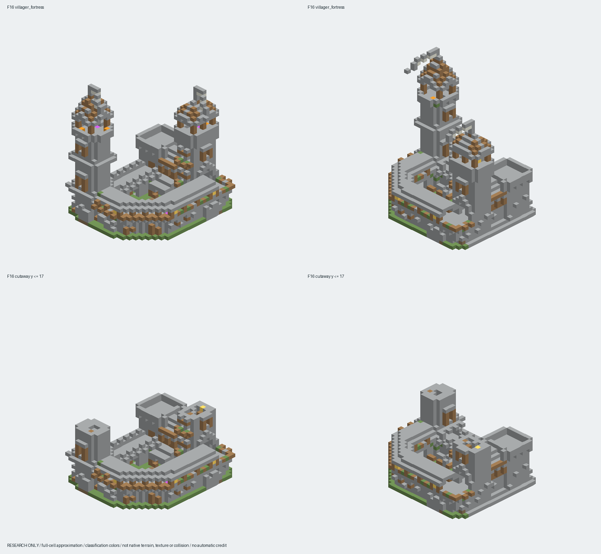
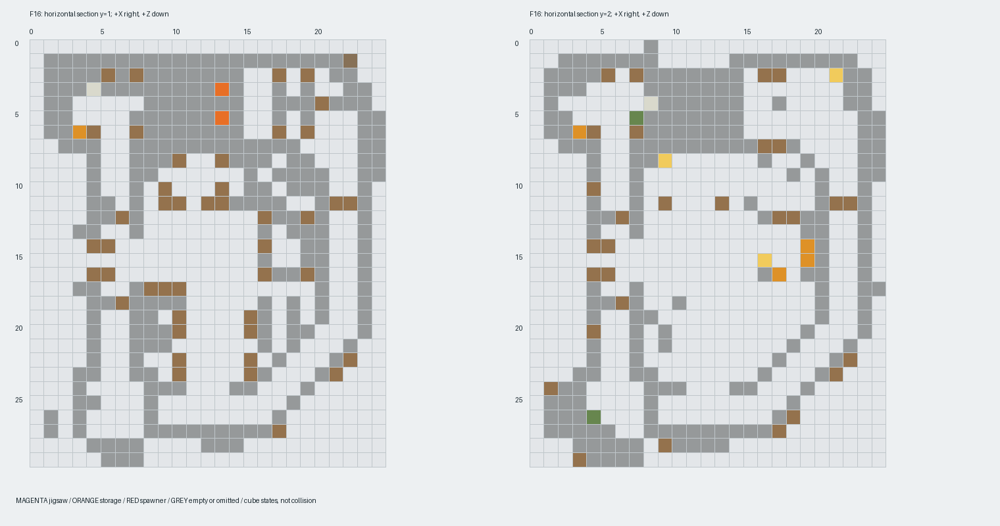
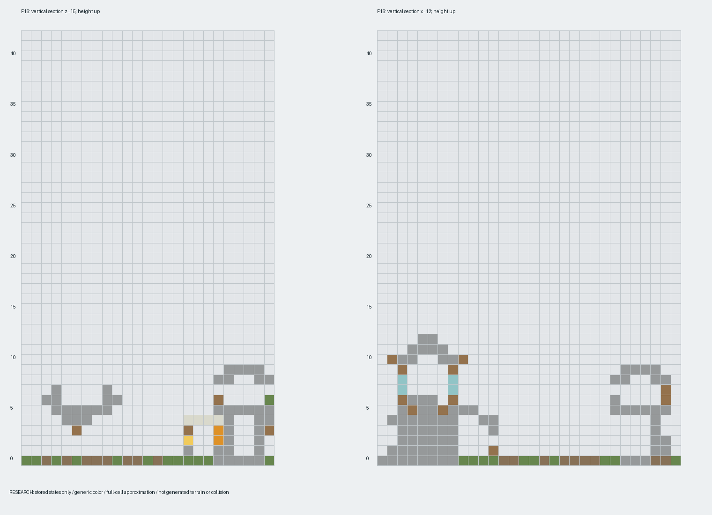
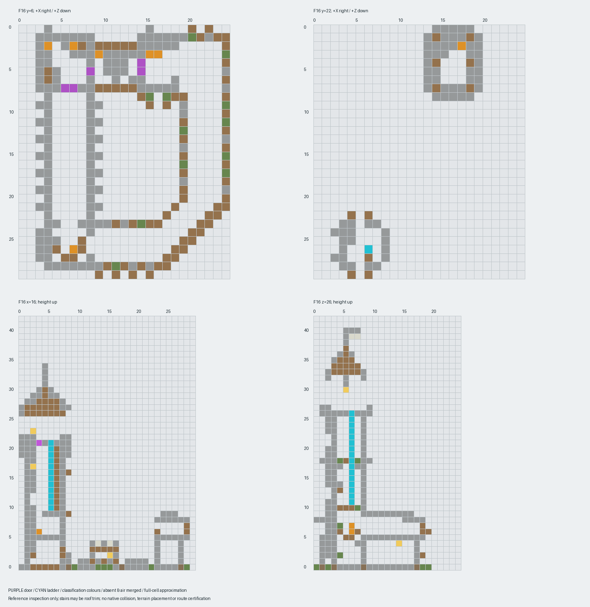

# 002-F16｜villager_fortress.nbt

**状态：证据已整理，具体用途/规模的信用尚待协调逐例验收；未增加正式参考数。**

双塔小院堡（25×43×30）：可借鉴小院、两塔和墙上通道；不是大型围城战区域。

仅用于DUN03相应城防节点的空间组织学习。不是已制作资产，不是整座古战场方案；不能跨用途、跨规模自动累计。此处尺寸为保存边界，包含屋尖、台脚及空余，不等于功能净尺寸。

## 来源与完整建筑范围

- 原始归档：`/Users/a15356015027/Desktop/专业剪辑软件/虚饰作品 v1.3/overrides/mods/[冒险;远足]trek-B0.6.1.jar`
- 归档SHA256：`fea95f69d7d023a8d990c043ee63bc07ea0a85cde1a558b369ef4884d3ac5012`
- 成员：`data/trek/structures/overworld/rare/villager_fortress.nbt`
- NBT SHA256：`45889a056fb370d612e202e6b9e1d678159486576b8cb54713e6f983ee874a83`
- [来源项目](https://modrinth.com/datapack/trek)：仅历史出处，本次未请求网络。
- 保存边界：`[25, 43, 30]`；模板外接池：`['trek:mobs/passive/horse', 'trek:mobs/villagers/taiga/unemployed']`。这些接口没有待组装房间池；地形/实体接口仍非生成验收。

下图由本地原始NBT生成，是已经实际查看过的结构研究图；不是作者原始截图或游戏实景。阶梯、栅栏等采用整格近似，不能证明原生碰撞、贴图、落地地形或安全通关。

图像SHA256：`77a92bdcadef7996a32b712e8962776c3affeedaeff5b47c77e7de6b009e6e97`

图像SHA256：`8f8474591eb022d35f2f5f1ee8d36807952ecc9fe1530dcc8be48823ef0c86b6`

图像SHA256：`b4e585c2dcfe65c6d0764f9ae4f1d2d6134d9e4e667ed01e1ab60be791d75ec5`

图像SHA256：`964b44f7110e3188ae4c4e94a74a8a73da7c2b7e054d07f9f063d26e45ae08e5`

## 七方面语义观察

- **布局**：低层围墙院内接前后不等高双塔与主屋，y6围墙步道绕院，y22仅双塔占地仍在；是一个完整小型院堡。
- **比例**：25×43×30，双塔细、院低；保存高度含尖帽上方细件，不能用全高推算各层人数容量。
- **立面**：石柱、木腰带与小窗形成横向环带，院墙上口连续，双塔位置不对称；不同于上一批单偏主塔围小院。
- **屋顶**：两塔各有木石尖帽，低主屋坡顶及院墙平顶形成三种屋面层级；塔帽不单独计设计。
- **材质**：stone、stone_bricks、spruce_stairs、grass_block、spruce_planks构成石木堡；含少量lava/TNT不能忽略真实碰撞与危险差异。
- **动线**：底层门y1接院内房，y6门接墙廊；(16,5)梯y10..21与(6,26)梯y11..26可从补剖确认。12个接口为村民/马，非外接房间。墙廊与双塔上下交通意图充分，未宣称游戏通关验收。
- **地形衔接**：草泥底与院墙脚完整保存，没有房间地基拼接；真实地形高差仍须后续验证。

## 去重与验收边界

细双塔围院与低墙廊；旧castle单偏高主塔加门楼，旧villager_castle是宽大围城与单侧高厅。

去重核对了101个历史本地归档/成员组合，含组件、待核资料，不等于有效建筑参考数。原文、旋转归一角色几何和纯占用几何均未发现完全匹配；相似度仅作辅助，不证明设计独立。
角色几何SHA256：`09423bbd77d03330b0ee78bdecef57e998d97f82b54672e74fa00d99c38770da`；纯占用几何SHA256：`2931e21bbd832aeb32437a940dee98636ce48d4fd831e6c72e2aa7f1a925e959`。

[完整去重证据](../research-20261101-dungeons-002/dedup-evidence.json) · [原逐例研究](../research-20261101-dungeons-002/manual-review.json)

来源、四张既有图与七方面记录已核验；完整建筑范围按整栋或整个院堡限定，塔、屋顶、楼层不能拆计。协调仍需按待制具体建筑的用途、规模审核相关性，决定是否纳入对应范围。未到该范围1000不开始制作，不因本记录删除主清单。
