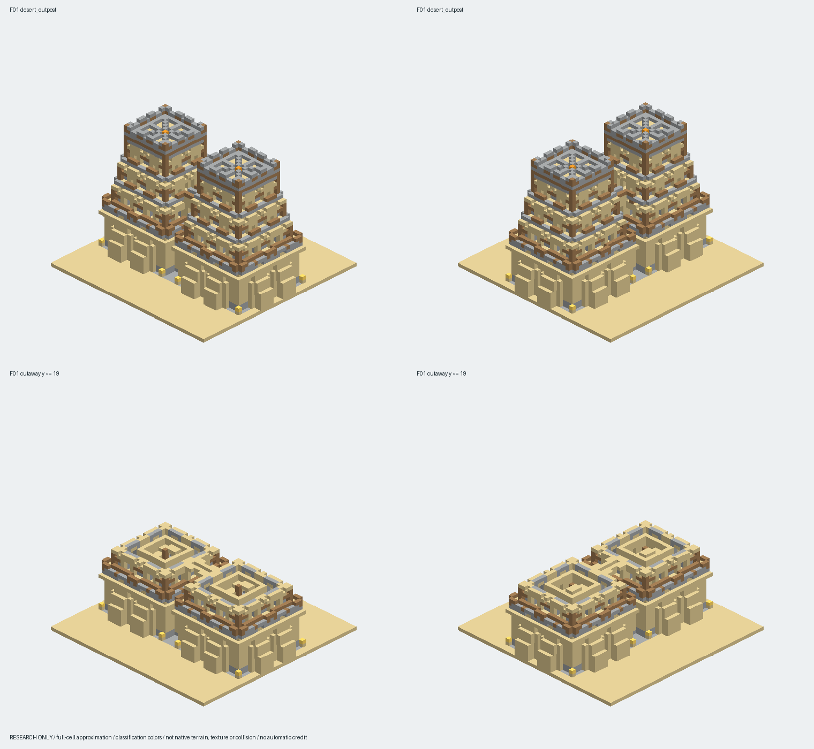
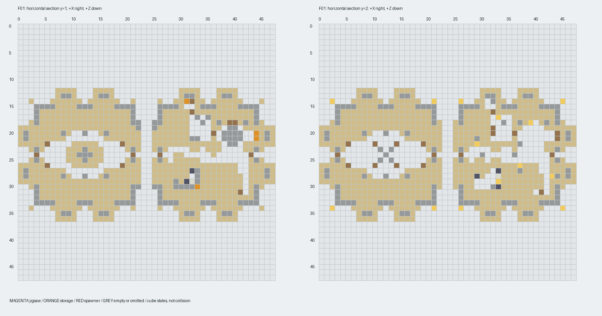
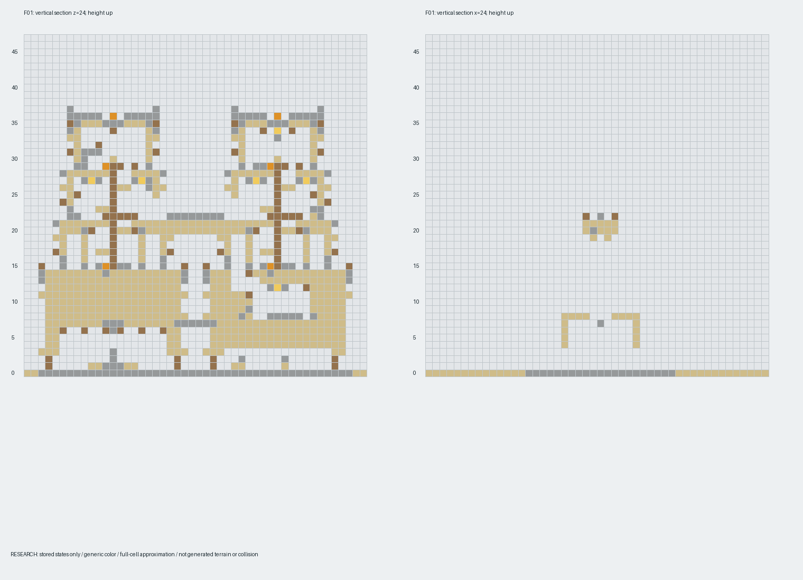
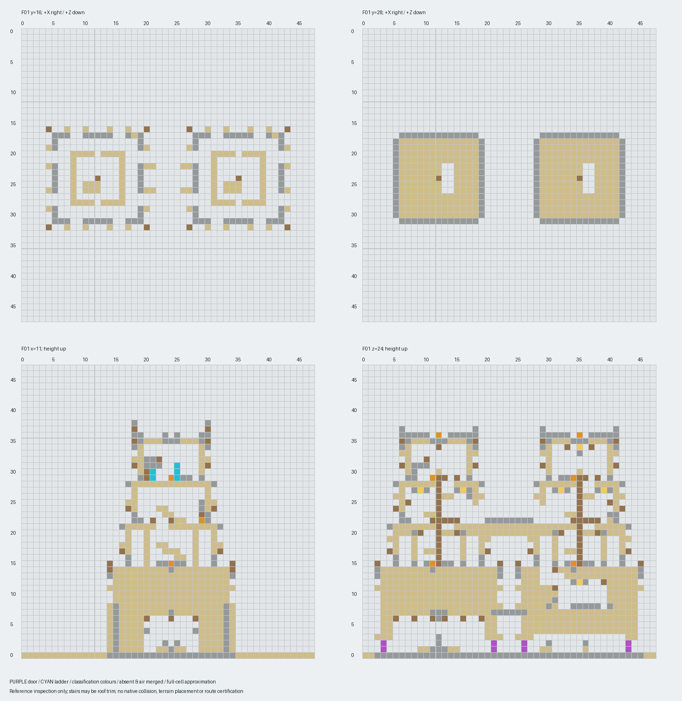

# 003-F01｜desert_outpost.nbt

**状态：证据已整理，具体用途/规模的信用尚待协调逐例验收；未增加正式参考数。**

双塔哨站（48³保存边界）：可借鉴双高塔夹低连接体与下层分室；不按双塔拆两例，不覆盖完整城池。

仅用于DUN03相应城防节点的空间组织学习。不是已制作资产，不是整座古战场方案；不能跨用途、跨规模自动累计。此处尺寸为保存边界，包含屋尖、台脚及空余，不等于功能净尺寸。

## 来源与完整建筑范围

- 原始归档：`/Users/a15356015027/Desktop/专业剪辑软件/虚饰作品 v1.3/overrides/mods/[冒险;ATi建筑轻量版]ATi Structures Default V1.4.2 (1.20+).jar`
- 归档SHA256：`1db9d6bbcc5032ed42e47adf42d2a719b5a768cc42af6b999ac2b1208d0730a7`
- 成员：`data/ati_structures/structures/desert_outpost.nbt`
- NBT SHA256：`6e69f2742ea7ec26347473bd4ffadff61779a59aea9a9f0633fe874151d65b4a`
- [来源项目](https://www.curseforge.com/minecraft/mc-mods/ati-structures)：仅历史出处，本次未请求网络。
- 保存边界：`[48, 48, 48]`；模板外接池：`['ati_structures:terrain_large']`。这些接口没有待组装房间池；地形/实体接口仍非生成验收。

下图由本地原始NBT生成，是已经实际查看过的结构研究图；不是作者原始截图或游戏实景。阶梯、栅栏等采用整格近似，不能证明原生碰撞、贴图、落地地形或安全通关。

图像SHA256：`74ec9ba46b643a51903210918d6c487cdba6b63767a98f7bfb5902d6aec74cc2`

图像SHA256：`9db59f18e73a132abd90e315e4f1001c1b957b16d021f77a529206e6e3d26c95`

图像SHA256：`c85593058c083eb260e975a30243b48919055f20f561fb324ec1e63ce49c8a77`

图像SHA256：`3efa3732788c5c1b498588f7691437aad483fb93e085ef38d335be0b5d9db73d`

## 七方面语义观察

- **布局**：两座高方塔夹低横向连接体，底层两侧分室与中央通道构成完整哨站；两塔属于同一建筑，不拆为两例。
- **比例**：保存边界48³，主体在约z12..36内横向展开，高塔和低连接体形成明确高差；保存方盒不是整栋实心体量。
- **立面**：浅砂岩墙以窄缝、木横带和外伸扶壁分节；底部柱墩与上层墙带有不同尺度。
- **屋顶**：两塔为收进的垛口平顶，连接体较低；不是两座坡顶塔或中式楼阁。
- **材质**：smooth_sandstone、sandstone、cut_sandstone、sand、purple_glazed_terracotta和sandstone_wall混用，颜色分类不等于原贴图。
- **动线**：底门七处y1、上门两处y8；x11补剖见y15..24阶梯状上行，z24剖面见约6/14/21/28/35层板，顶层短梯y29..31。有空间联系意图，未认证原生碰撞与通顶通关。
- **地形衔接**：宽砂岩承台配terrain_large接口，模板中无待接侧房；承台如何落到自然沙坡仍未验证。

## 去重与验收边界

两座高方塔夹低横向连接体，底层两侧分室与中央通道构成完整哨站；两塔属于同一建筑，不拆为两例。 两塔为收进的垛口平顶，连接体较低；不是两座坡顶塔或中式楼阁。

去重核对了117个历史本地归档/成员组合，含组件、待核资料，不等于有效建筑参考数。原文、旋转归一角色几何和纯占用几何均未发现完全匹配；相似度仅作辅助，不证明设计独立。
角色几何SHA256：`5ceb4ffc1b06e534bebc295ed00c248310c14f101ab152b57294b82679862194`；纯占用几何SHA256：`93a24dad8ac1d34bb519b99f2826ee2c08b9d7f3a9a76fb24c4ebd63ccf00337`。

[完整去重证据](../research-20261101-dungeons-003/dedup-evidence.json) · [原逐例研究](../research-20261101-dungeons-003/manual-review.json)

来源、四张既有图与七方面记录已核验；完整建筑范围按整栋或整个院堡限定，塔、屋顶、楼层不能拆计。协调仍需按待制具体建筑的用途、规模审核相关性，决定是否纳入对应范围。未到该范围1000不开始制作，不因本记录删除主清单。
