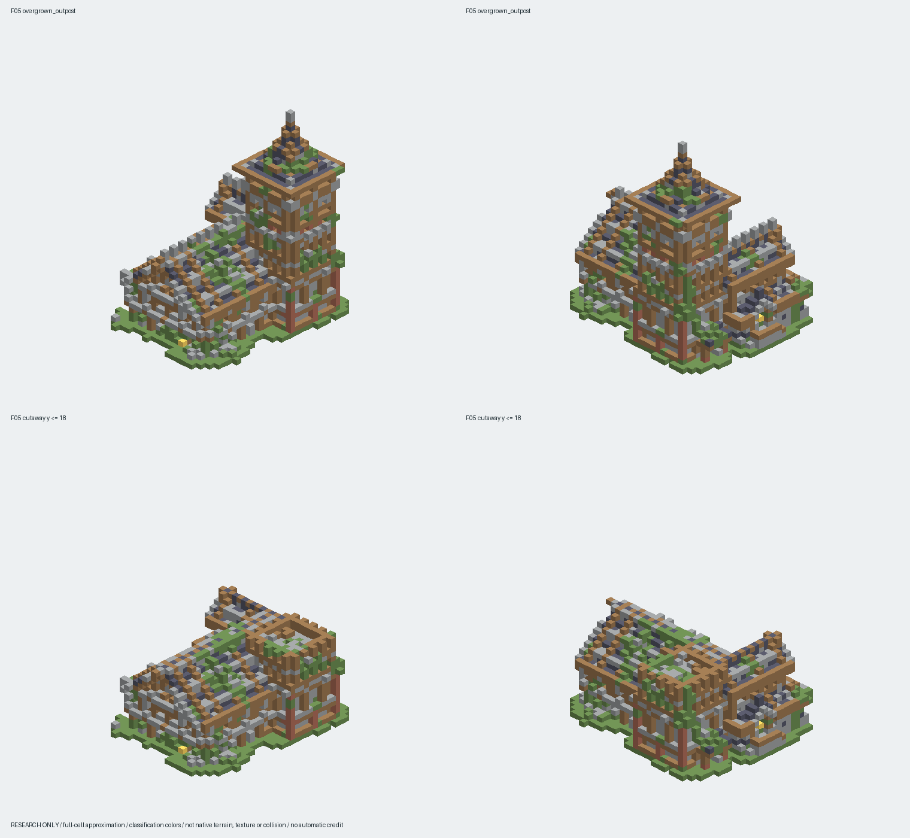
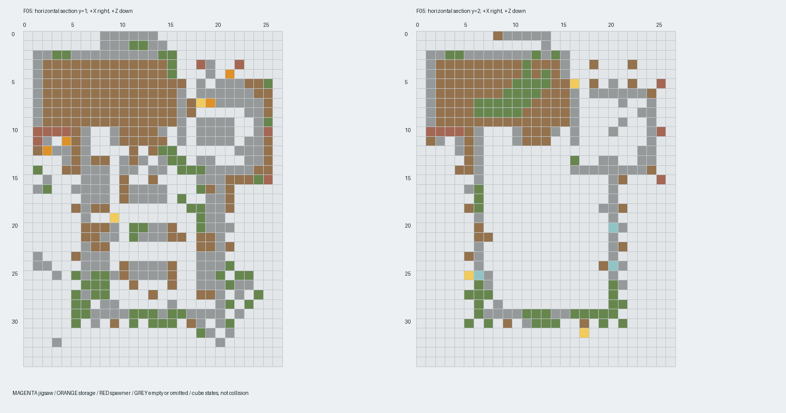
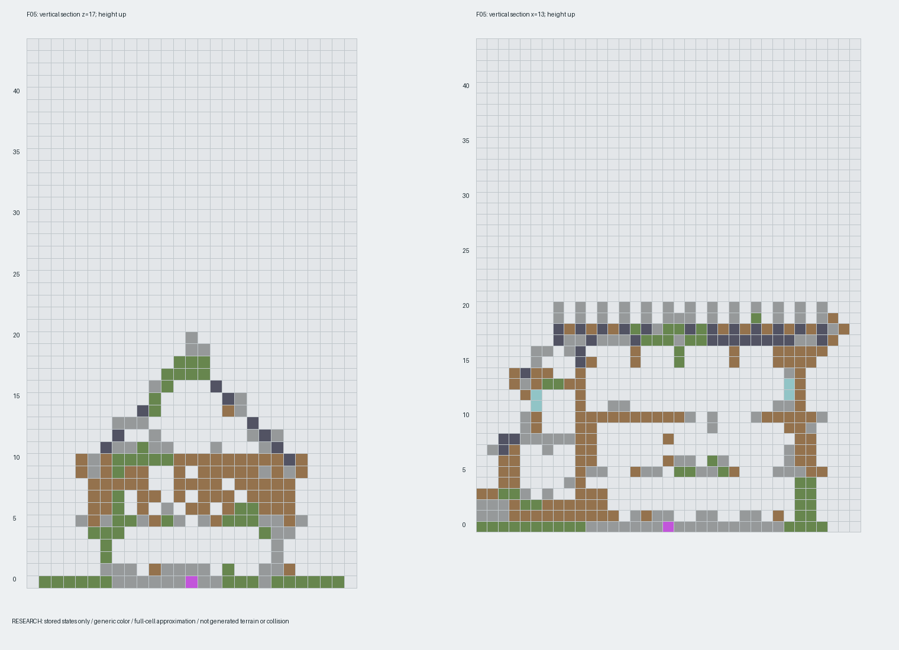
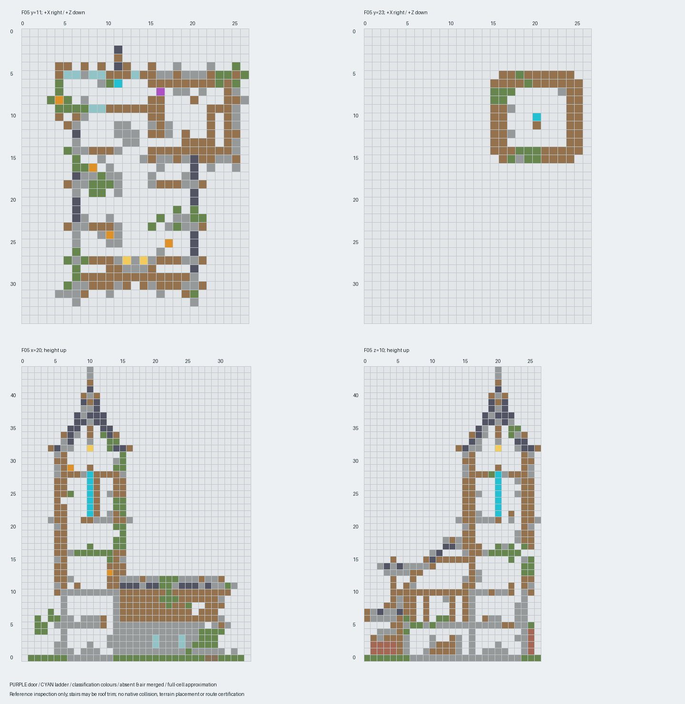

# 003-F05｜overgrown_outpost.nbt

**状态：证据已整理，具体用途/规模的信用尚待协调逐例验收；未增加正式参考数。**

高角塔连L形低厅（27×45×35）：可借鉴角塔控向与低厅组合；不覆盖多角塔围城。

仅用于DUN03相应城防节点的空间组织学习。不是已制作资产，不是整座古战场方案；不能跨用途、跨规模自动累计。此处尺寸为保存边界，包含屋尖、台脚及空余，不等于功能净尺寸。

## 来源与完整建筑范围

- 原始归档：`/Users/a15356015027/Desktop/专业剪辑软件/虚饰作品 v1.3/overrides/mods/[冒险;ATi建筑轻量版]ATi Structures Default V1.4.2 (1.20+).jar`
- 归档SHA256：`1db9d6bbcc5032ed42e47adf42d2a719b5a768cc42af6b999ac2b1208d0730a7`
- 成员：`data/ati_structures/structures/overgrown_outpost.nbt`
- NBT SHA256：`9903f17c339631d0c6235b9fc161993f916ee96a377002cc8c37c229ccf347da`
- [来源项目](https://www.curseforge.com/minecraft/mc-mods/ati-structures)：仅历史出处，本次未请求网络。
- 保存边界：`[27, 45, 35]`；模板外接池：`['ati_structures:terrain_large']`。这些接口没有待组装房间池；地形/实体接口仍非生成验收。

下图由本地原始NBT生成，是已经实际查看过的结构研究图；不是作者原始截图或游戏实景。阶梯、栅栏等采用整格近似，不能证明原生碰撞、贴图、落地地形或安全通关。

图像SHA256：`547c0a5d9dd331c2cde598e093b7dfa69b55cb16ebe80a7baca478a23572f4f1`

图像SHA256：`403663b622a25a105166978900940b39427e8a8a1a36534fb36043aa750d66d6`

图像SHA256：`8ea6da74dbf73fd75e8baa2aba2c6173b1f433bf1e28c56e2bf9f845ff39ee40`

图像SHA256：`20581f4294fc6e459f5c439ee392cf876dbe8ba0f8ef28559eebc02ef338cc97`

## 七方面语义观察

- **布局**：L形低厅与单角高木塔相连，低层围出局部空地；不同于旧TREK castle的厚石周墙和多角塔院。
- **比例**：27×45×35，高塔尖到约y44、塔室主要y21..31，低厅约y6..13；以高角塔控制方向而非等高对称四塔。
- **立面**：木柱横带、深灰石边和覆绿层共同分节，塔下长柱与低厅门窗尺度不同，藤叶不替代柱脚。
- **屋顶**：角塔陡尖顶及低厅坡顶相接，屋尖细长；y23平面仍是单个塔室，不能将屋尖再计一层房。
- **材质**：oak_leaves、spruce_trapdoor、stripped_spruce_wood、grass_block、spruce_stairs和mangrove_wood混用。
- **动线**：门在y1、6、11；x20/z10补剖见y21及y28塔内层板，x20,z10有y22..28连续梯。另一梯x11,z6仅y9..12，底门至高塔完整路线尚非游戏验收。
- **地形衔接**：高低台脚在模板内，terrain_large负责外部承托；可学哨塔与厅的分工，不认定已适配真实森林坡地。

## 去重与验收边界

L形低厅与单角高木塔相连，低层围出局部空地；不同于旧TREK castle的厚石周墙和多角塔院。 角塔陡尖顶及低厅坡顶相接，屋尖细长；y23平面仍是单个塔室，不能将屋尖再计一层房。

去重核对了117个历史本地归档/成员组合，含组件、待核资料，不等于有效建筑参考数。原文、旋转归一角色几何和纯占用几何均未发现完全匹配；相似度仅作辅助，不证明设计独立。
角色几何SHA256：`490b94e5bd137bf73e93b966ae9339b86d2b1c900fce6fa46c66a50b2e02039c`；纯占用几何SHA256：`4b431929f8ffd0ed799cb1931b3cd97eef4b58487b5b0fe28aa0dfb9aa8afda1`。

[完整去重证据](../research-20261101-dungeons-003/dedup-evidence.json) · [原逐例研究](../research-20261101-dungeons-003/manual-review.json)

来源、四张既有图与七方面记录已核验；完整建筑范围按整栋或整个院堡限定，塔、屋顶、楼层不能拆计。协调仍需按待制具体建筑的用途、规模审核相关性，决定是否纳入对应范围。未到该范围1000不开始制作，不因本记录删除主清单。
