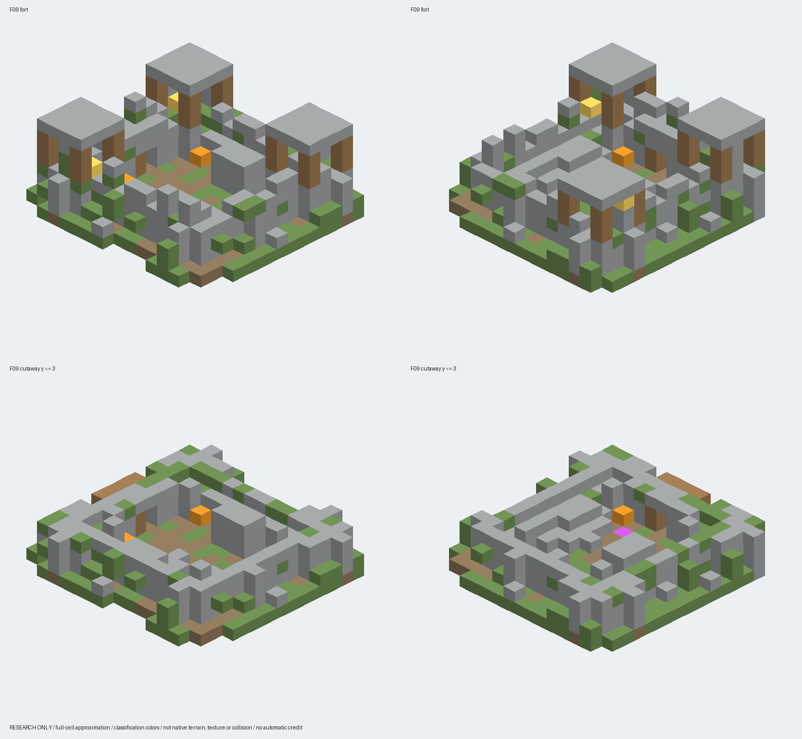
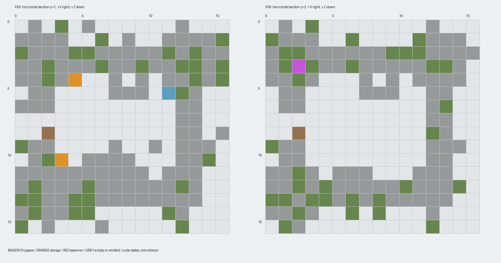
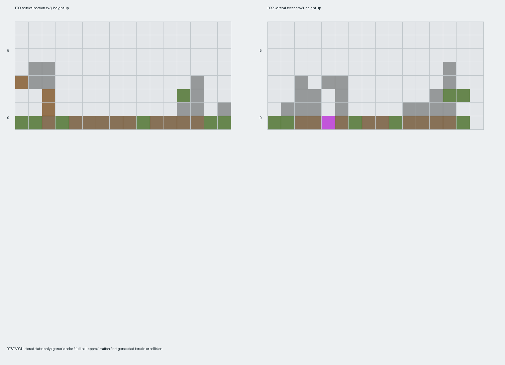
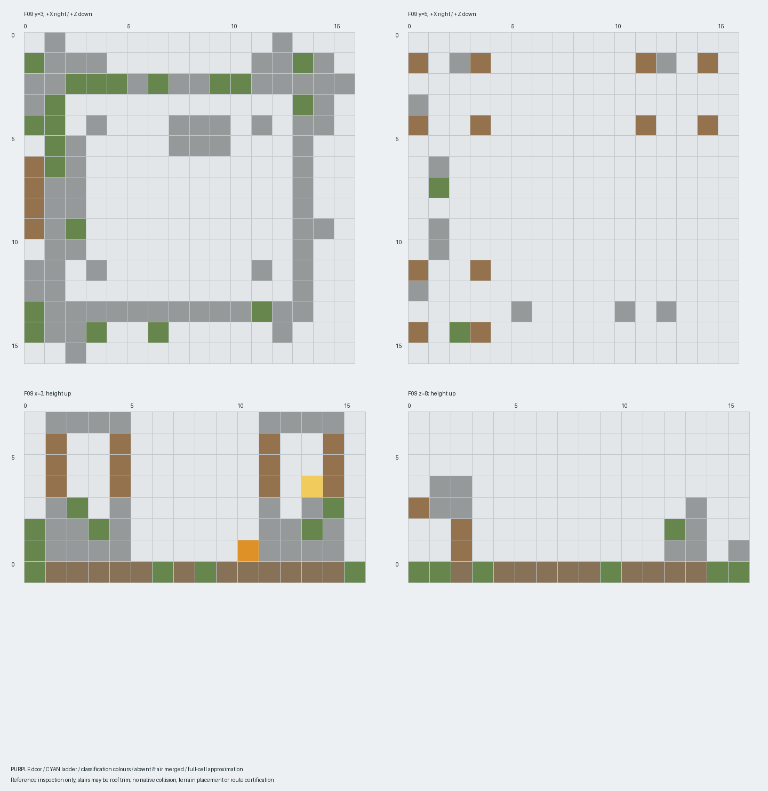

# 003-F09｜fort.nbt

**状态：证据已整理，具体用途/规模的信用尚待协调逐例验收；未增加正式参考数。**

近地四角哨棚围院（16×8×16）：可借鉴小哨堡低墙、入口与开院；不覆盖高堡、瓮城或整座战场。

仅用于DUN03相应城防节点的空间组织学习。不是已制作资产，不是整座古战场方案；不能跨用途、跨规模自动累计。此处尺寸为保存边界，包含屋尖、台脚及空余，不等于功能净尺寸。

## 来源与完整建筑范围

- 原始归档：`/Users/a15356015027/Desktop/专业剪辑软件/虚饰作品 v1.3/overrides/mods/[冒险;远足]trek-B0.6.1.jar`
- 归档SHA256：`fea95f69d7d023a8d990c043ee63bc07ea0a85cde1a558b369ef4884d3ac5012`
- 成员：`data/trek/structures/overworld/medium/fort.nbt`
- NBT SHA256：`5c6f6696eb274b9008b1891ab3a4f513885b5527befea97b5f73398ec6a2f05a`
- [来源项目](https://modrinth.com/datapack/trek)：仅历史出处，本次未请求网络。
- 保存边界：`[16, 8, 16]`；模板外接池：`['trek:mobs/pillagers/pillager', 'trek:mobs/villagers/plains/unemployed']`。这些接口没有待组装房间池；地形/实体接口仍非生成验收。

下图由本地原始NBT生成，是已经实际查看过的结构研究图；不是作者原始截图或游戏实景。阶梯、栅栏等采用整格近似，不能证明原生碰撞、贴图、落地地形或安全通关。

图像SHA256：`acb5b80c5a7bad71bdd9d28423e85de6bf07bcf02aad3912867caba77f6218c0`

图像SHA256：`0eff2a7c6035aad6f23eb33b542a9a705a9fd825c87994044c01203f9e17fb7c`

图像SHA256：`74020bdc1a3b3a483f6b35c577d557545ec8fa63f0a970a70ae2f0a19ca2c406`

图像SHA256：`a5c2497f95124a0ff4db170bcb06ee82b388fdbe49bc5ac1b5afed16330e5a26`

## 七方面语义观察

- **布局**：完整小型方围院，四角哨棚、低石围墙和一侧入口围空院；与旧stray_ruins的破墙残台不同。
- **比例**：16×8×16，开院大于角棚，围墙低于棚顶；这是小哨堡尺度，不夸大为整座战场。
- **立面**：低石墙提供连续边界，木柱支角棚，入口不装门扇；不是只换色的桦木树台或冰柱。
- **屋顶**：四角短平棚罩院角而院心敞开，55格campfire参与构成棚顶；通用灰色不意味着混凝土整板。
- **材质**：stone_bricks、dirt、mossy_stone_bricks、grass_block、campfire和spruce_fence构成石木围院。
- **动线**：无门扇、无梯；z8剖面可见入口侧低开口，y3补平面显示四边围墙和空院。无高层交通需求，不能因无梯判整堡残缺；真实棚顶碰撞未验。
- **地形衔接**：四个接口均为实体池（三掠夺者、一村民），不缺四个房间；草泥低基座着地仍待实际生成验证。

## 去重与验收边界

完整小型方围院，四角哨棚、低石围墙和一侧入口围空院；与旧stray_ruins的破墙残台不同。 四角短平棚罩院角而院心敞开，55格campfire参与构成棚顶；通用灰色不意味着混凝土整板。

去重核对了117个历史本地归档/成员组合，含组件、待核资料，不等于有效建筑参考数。原文、旋转归一角色几何和纯占用几何均未发现完全匹配；相似度仅作辅助，不证明设计独立。
角色几何SHA256：`215ba0f30fb5666d7e0cb5b964a6180477f70edfd00329d1dd3435ba2f611f4d`；纯占用几何SHA256：`972252c60ce1493845c3cf9012a717a637df5108db014fdb71f49bd6523db8b8`。

[完整去重证据](../research-20261101-dungeons-003/dedup-evidence.json) · [原逐例研究](../research-20261101-dungeons-003/manual-review.json)

来源、四张既有图与七方面记录已核验；完整建筑范围按整栋或整个院堡限定，塔、屋顶、楼层不能拆计。协调仍需按待制具体建筑的用途、规模审核相关性，决定是否纳入对应范围。未到该范围1000不开始制作，不因本记录删除主清单。
