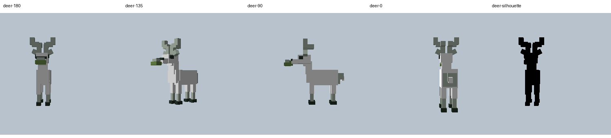

# 衔草白鹿：秘密 12 实际资源与验收

本批完成真实 `dynasty:white_deer` 实体、静步跟随判定、每玩家一次的白鹿灵契，以及可以进入、保存并安全返回的 `dynasty:white_deer_grotto`。技术与美术来源、观察范围及原创设计见 [参考记录](references.md)。



37 个 Cuboid、23 个骨骼，横向躯干、阶梯颈、突出鼻帽、粗角枝、四条上腿→小腿→蹄链。灵芝随头部挂点运动。PNG 实际为 16×16、最多四色、白底两像素留边和至少 2×2 色块；UV 仅采明确定义的前景色岛。鼻部、灵芝顶部和尾尖已消除异色共面。五组动画为 idle、walk、graze、look_back、startled。

正式资源位于 `src/main/resources/assets/dynasty/{geo,animations,textures/entity}/cod3/white_deer.*`，物品图标为 `textures/item/white_deer_token.png`。可编辑源为 [white_deer.bbmodel](blockbench/white_deer.bbmodel)，动画源放在同目录。生成脚本只修改本批资源及中英文白鹿词条；只读检查不会重新生成资源。

## 玩家流程

白鹿在主世界竹林早晨稀少生成，口衔灵芝，伴有轻雾和铃声。潜行在 1.5–10 格内、保持视线并跟随同一只鹿。连续 6000 服务器 tick，且双方各行走至少 30 格，才获得个人灵契。站起、骑乘、惊扰、超距、传送、长时间静止、断线或切维度会清除未完成进度。只需在晨间开始，之后允许继续至白天。击杀没有捷径掉落，白鹿不可骑乘。

灵契绑定持有者 UUID 与该玩家的领取记录；其他玩家不能借来解锁。获认可后可右键白鹿或使用灵契进入洞天，再用灵契返回。丢失灵契时可空手使用洞天的归返铃。洞天是共享的独立竹林小院，进入资格和返回点各自保存，不声称每人获得一张私人地图。首次建造后不会覆盖玩家改动。返回先检查原位置附近安全落脚点，受阻时回退主世界/目标维度出生点；都不安全则留在洞天并显示提示。

## 本批验证

最终 `deer-v9` 原生集成 Forge 客户端通过 92 种独立检查，生成 17 张画面。核对五视角、纯黑剪影、五动画各两个实际播放姿势、口衔挂点、真实寻路、资源重载、灵契进入和空手归返铃退出、奖励隔离、唯一领取与实际落盘。

- [机器可读验收](verification.json)、[原始检查](native/checks.txt)、[动画姿态](native/poses.json)。
- [游戏低头动作](native/world-graze-1.png)、[洞天实景](native/grotto-world.png)、[像素图稿](textures-review.png)。
- 游戏镜头已逐张人工复查；静态检查另外拦截异色同向共面、UV 越界、骨骼引用错误与编辑源不一致。
- 五分钟门槛使用隔离世界的服务器时钟加速；寻路与动画使用真实 tick。两名领取者由服务器 FakePlayer 表示，未进行第二台网络客户端联机或完整 JVM 重启。本批不会把这些范围外项目写成通过。

本批 JAR：`build/cod3-white-deer-20261011/dynasty-1.4.0-cod3-white-deer.jar`，SHA-256：`5e620172d7480b7e17f59f2c56402ea6d2a80ff43c9c2d3daf6d480558062351`。十个直接资源在源码、冻结运行目录和 JAR 中字节一致；正式 JAR 不包含 QA 类。保留了前期诊断运行，没有使用失败运行作为验收证据。

## 复验

一般只需运行 `PYTHONWARNINGS=ignore python3 tools/art/cod3/validate_white_deer.py`。不要为只读检查运行生成脚本，也不要重复启动游戏。

需要实际客户端复验时，先用新的 run ID 顺序准备、冻结、运行；使用独立输出与 Gradle 缓存，避免其他开发任务覆盖运行字节：

```sh
./gradlew --offline --no-build-cache --max-workers=2 \
  --project-cache-dir build/cod3-white-deer-20261011/gradle-cache \
  -Dorg.gradle.java.home=/Library/Java/JavaVirtualMachines/temurin-17.jdk/Contents/Home \
  -I tools/cod3/isolated-build.init.gradle \
  -Pcod3IsolatedBuild=build/cod3-white-deer-20261011/compiled \
  -I tools/maintenance/pr_repair_qa.init.gradle \
  -I tools/art/cod3/white_deer.init.gradle \
  -Pcod3WhiteDeerRun=<fresh-run> -Pcod3WhiteDeerPrepare runClient build
python3 tools/blueprint/freeze_client_classpath.py \
  --launch build/cod3-white-deer-20261011/launch-<fresh-run>.json <fresh-freeze>
python3 tools/art/cod3/run_white_deer_client.py \
  build/blueprint-client/frozen/<fresh-freeze>/launch.json
python3 tools/art/cod3/collect_white_deer_evidence.py --run <fresh-run> --frozen <fresh-freeze>
```

collector 的 `--clean-prompts` 只用于首次验收后删两条白鹿原文。删除后再次运行该开关会拒绝操作，避免误删或重复累计。
